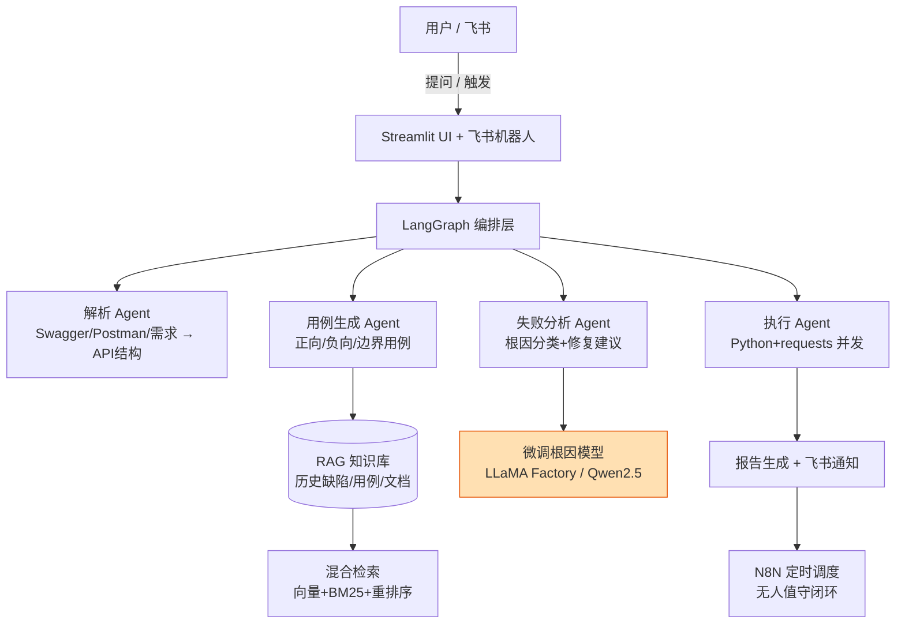

# AI驱动的智能测试助手

## 基于 RAG + 多智能体 + 模型微调的接口测试全流程系统

> **双重身份**：本目录项目同时作为 **① 毕业设计（毕设）核心项目** 与 **② 简历作品集 · 项目3**。  
> 由「AI驱动的智能测试知识库助手（RAG）」与「AI驱动的智能接口测试助手（多智能体）」合并而成。  
> **毕设路径**：路径 A（结合 7 年测试经验，推荐）× 全流程项目（+10，强烈推荐）—— 既贴合背景又有最高加分。

---

## 一、项目定位

面向软件测试工程师的大模型应用。把"文档 / 缺陷 / 用例"变成可被大模型调用的知识，把"用例生成 → 执行 → 分析 → 报告"变成由 Agent + 微调模型编排的自动化流水线。**四大能力**：

1. **测试知识库（RAG）**：历史缺陷 / 测试用例 / 接口文档向量化，混合检索 + 重排序 + 定量评估（MRR / NDCG）。
2. **接口测试用例自动生成**：从 Swagger / Postman / 需求文档解析 API，LangGraph 多智能体生成正向 / 负向 / 边界用例。
3. **用例执行与失败根因分析**：Python + requests 执行；失败分析由 **微调的缺陷根因分类模型 + Agent** 联合给出根因与修复建议。
4. **自动化闭环**：N8N 定时触发 → 执行 → 报告 → 飞书通知，无人值守。

---

## 二、为什么适合你（答辩 / 简历双用）

- **7 年测试 / 性能专项经验** → 深刻理解接口测试痛点（用例设计耗时、漏测、结果分析繁琐），项目有真实业务价值，路径 A 复用经验最占便宜。
- 技术栈 Python（已熟练）、API 调用、自动化、性能测试 → 完全可驾驭。
- 评委 / 面试官看到的是 **业务洞察 + LLM 工程能力（RAG + 微调 + 多智能体 + 自动化）**，而非简单 CRUD。

---

## 三、技术架构



> 橙色节点（微调模型）是本项目相对 FinWise / MCP 工具箱的**唯一差异化能力**，也是毕设「全流程 +10」的关键。


---

## 四、技术栈（满足毕设强制要求 + 加分）

- **强制**：LangChain 1.x · LangGraph · RAG · Chroma（向量库）
- **核心**：LLaMA Factory（LoRA 微调）· bge-small-zh（Embedding）· bge-reranker-v2（重排序）· DeepSeek / Qwen API
- **应用（全 Python 3.10+）**：Python / requests · Streamlit（进程内调用 Python 模块）· N8N（外部调度）· 飞书多维表格（FastAPI 仅作可选 HTTP 桥）
- **加分拓展**：CrewAI（用例生成-评审双 Agent，冲「多智能体框架 +5」）· Coze（对话式测试助手 MVP，冲「多项目 +5」）

---

## 五、核心功能（技术深度展示）

- **多智能体协作（LangGraph）**：解析 / 生成 / 执行 / 分析 四 Agent 状态机编排，支持失败重试与人工介入点。
- **模型微调闭环（LLaMA Factory）**：Label Studio 标注历史缺陷根因 → 微调 Qwen2.5 分类模型 → 接入失败分析 Agent，实现"标注→训练→应用"全链路。
- **RAG 增强用例生成**：生成用例时检索历史缺陷，自动补充易错边界 / 异常场景（如"该接口空参数曾返回 500，请增加空参数用例"）。
- **混合检索 + 重排序 + 评估体系**：向量 + BM25 融合、Cross-encoder 重排序、MRR / NDCG 定量评估，RAG 检索 Top-3 准确率 ≥ 90%。
- **自动化闭环**：N8N 定时 → 执行 → 报告 → 飞书通知。

---

## 六、量化业务价值（对齐毕设成功案例）

| 指标               | 目标 / 实测         | 说明                         |
| ---------------- | --------------- | -------------------------- |
| RAG 检索 Top-3 准确率 | ≥ 90%           | 对齐成功案例「RAG 准确率 90%+」       |
| 用例生成效率           | 提升 ≥ 70%        | 单接口用例从人工 30min → 自动 < 5min |
| 缺陷根因分类准确率        | ≥ 85%           | 微调模型在测试集上的分类准确率            |
| 漏测场景补充           | 每个接口平均 +3 条异常用例 | RAG 检索历史缺陷自动补场景            |
| 回归测试人力           | 下降 ≥ 60%        | N8N 无人值守闭环替代每日手动           |

---

## 七、与作品集其他项目的分工（避免重复）

| 项目           | 主打能力                         | 本项目的差异点                |
| ------------ | ---------------------------- | ---------------------- |
| FinWise      | 复杂 Agent 编排（业务型）             | 本项目的 Agent 聚焦"测试工作流"   |
| MCP工具箱       | 工具 / 协议                      | 本项目调用被测系统 API，不造工具     |
| **本项目（项目3）** | **RAG + 微调 + 多智能体 + 全流程自动化** | **唯一覆盖"模型微调 + 端到端闭环"** |

---

## 八、毕设加分项映射（最大化策略）

| 加分项                          | 分值      | 本项目体现                                                   | 优先级    |
| ---------------------------- | ------- | ------------------------------------------------------- | ------ |
| 全流程项目（标注→训练→应用→N8N）          | **+10** | Label Studio 标注 → LLaMA Factory 微调 → LangGraph 应用 → N8N | **必做** |
| N8N 智能体编排                    | +5      | 定时测试 → 报告 → 飞书通知                                        | **必做** |
| 模型训练 / 微调                    | +5      | LLaMA Factory 微调缺陷根因模型                                  | **必做** |
| 多智能体框架（CrewAI/AutoGen/Swarm） | +5      | 用例生成-评审双 Agent（CrewAI）                                  | 争取     |
| Coze / Dify MVP              | +5      | 对话式测试助手 MVP（独立小项目）                                      | 可选     |

> **保底**：必做三项 = 全流程(+10) + N8N(+5) + 微调(+5) = **+20**，配合基础分稳过（及格线 70）。  
> **冲满**：再加 CrewAI(+5) 或 Coze MVP(+5) = **+25**。  
> ⚠️ 注意：LangGraph 多 Agent 是毕设**强制技术**，不计入「多智能体框架 +5」；该加分需用 CrewAI/AutoGen/Swarm，本项目用 CrewAI 实现"生成+评审"双 Agent 争取。

---

## 九、快速开始（毕设提交模板）

### 当前已接入的问答链路

主图已接入统一 `dialogue` 子图：JEV 一次识别业务意图与回答策略，子图确定性分流到普通回答或项目检索回答。
检索复用本地 BGE-M3 和 BGE-Reranker，Milvus 使用独立 TestMind 集合；没有授权上下文或证据时明确反馈。
配置、集合字段、权限接入和测试方法见 [问答子图与本地检索](docs/09-问答子图与本地检索.md)。
该实现不等于已完成语料入库、登录权限系统或实库端到端联调。

### 环境要求

- Python 3.11+ · uv · Git；PostgreSQL 用于检查点，Milvus 用于知识查询
- API Key：DeepSeek / Qwen（`.env` 配置）

### 安装步骤

模型统一放在本项目的 `pretrained_model/bge-m3` 和 `pretrained_model/bge-reranker-base`。
权重由 Git 忽略，不依赖其他仓库目录；首次克隆后按 [本地模型准备说明](pretrained_model/README.md) 下载。

```powershell
uv sync
# 使用 .env.example 中的配置项设置 .env，保留已有配置与凭据。
uv run python -m testmind.main
# 离线单测与本地模型验证
uv run pytest tests/unit -q
uv run python scripts/smoke_local_retrieval.py
```

### 项目结构

```
project/
├── data/            # 测试文档 / 缺陷库 / 接口文档 / 标注数据
├── src/             # 源代码（rag / agents / executor / finetune / n8n）
├── config/          # 模型 / 检索 / 微调配置
├── tests/           # 单元测试 + 评估脚本（MRR/NDCG）
├── notebooks/       # 微调实验记录
├── requirements.txt
└── README.md
```

### 演示截图

- [图1] Streamlit 知识库问答界面（带引用来源）
- [图2] LangGraph 四 Agent 用例生成-执行链路
- [图3] N8N 定时触发 → 飞书报告推送

---

## 十、作者信息

### 知识入库工作流

知识工作流已拆分为独立 FastAPI 后台与 PostgreSQL 租约 Worker：上传、版本、质量报告、重试、重建索引、删除、激活和审计均通过服务端接口完成。读写接口都要求服务端授权上下文；未配置授权提供方时 fail closed。PostgreSQL 的 active version mapping 是检索权威，Milvus `is_active` 用于辅助过滤与对账。

本地启动 Streamlit 操作页：

```powershell
uv run streamlit run frontend/streamlit/app.py
```

知识迁移使用独立的 `knowledge` schema 和 `knowledge_alembic.ini`，避免与 LangGraph checkpoint 迁移冲突。生产环境应配置共享对象存储（MinIO/S3）和可信授权提供方；ZenTao 事件适配器默认关闭，启用前需要配置签名密钥及外部事件契约。

- 姓名：[杨泽森]
- 岗位方向：大模型应用开发
- 项目角色：独立设计 + 实现（架构 / 微调 / 工程化）

---

## 相关

- [[PRD|项目需求文档（速览）]]
- [[一周排期|毕设 Day1-7 排期（速览）]]
- [[面试亮点|面试 / 答辩怎么讲这个项目]]
- [docs/ 敏捷开发流程文档](docs/00-敏捷开发文档索引.md)（立项书 / PRD / Backlog / TDD / Sprint / 验收测试）
