# 04 技术设计文档（TDD）

> 客户端范围：Web only。工作台通过浏览器访问 Web UI/API；响应式移动网页属于同一 Web 客户端，不建设或验收 iOS/Android 原生 App。

> 2026-10-14 P5/P6 本地演示：已装配主图任务路径并统一未启用能力终态；澄清恢复清除旧输出，知识回答历史读取复核当前授权/有效版本，来源/用例发布/图谱事件使用 PG 事务 Outbox。运行时由独立 Compose 项目、不可变 Alembic 迁移和模型 SHA-256 指纹约束；深度就绪检查 API 与三个 Worker。Worker 心跳、项目运维状态和单用户有界队列落 PG；本机容量测试只覆盖入队/PG。PG 备份还原后在隔离集合与图谱代际重建 Milvus/Neo4j 投影。演示身份及禅道适配器不构成生产身份/外部写入验收，固定检索集为 3/4，不宣称模型质量通过。

> 2026-10-14 P4：`DemoGraphSource` 使用独立持久化事件日志及提交有序序号，复用 GraphPoller/graph_sync receipts、水位、Outbox 和独立 graph-worker。成员新版本在 PG 登记事务中更新角色/维护权限，过期成员事件不重新授权。`GraphQueryNode` 使用私有 GraphQueryState 和受限 DTO；主图直接路由，不经问答指代消解。Neo4j 查询模板有超时与分页边界，结果核验 PG 修订/指纹/显式关系，展示字段来自 PG 权威快照；指标统一从授权 PG 快照聚合。图谱任务历史读取复核 permission_version。排队维护执行前复核调用者，隔离代际切换在事务中校验最新快照、租约和维护授权；同版本冲突通过新代际修复。旧代际只提供 24 小时保留清理预览。来源本地模拟，PG/Neo4j 真实；生产禅道、SSO、P5 自动业务事件仍待实现。

> 2026-10-14 本地 P2/P3：`SharedRetrievalService` 以私有 RetrievalState/版本化 EvidenceBundle 复用 Milvus/BGE，检索前后和引用返回前重新读取 PG 授权/有效版本。知识入库运行独立 Worker，解析使用有时间/大小/页数/字符边界的子进程；模型预热位于任务租约外。用例分支直接路由至 CaseDesignNode，不经过问答指代消解；需求/OpenAPI 规则模板生成正负边界草稿，保存完整来源快照、证据版本、版本/hash、逐条审批和操作账本。模拟写入单独适配器使用同一 PG 权威检查及唯一操作键，超时后查询结果，未知结果保持 needs_reconciliation；不声称真实禅道的 exactly-once。迁移 `20261014_0003_cases.py` 在原任务账本上增加用例资产/历史/自动来源水位/模拟外部记录。基本 AI 边界与结构化停止原因沿用 P1，不记录隐藏思维链。

| 字段   | 内容                                      |
| ---- | --------------------------------------- |
| 文档版本 | v2.0                                    |
| 更新日期 | 2026-10-13                              |
| 产品名称 | TestMind                                |
| 文档类型 | Technical Design Document               |
| 关联   | 02 PRD · 03 Backlog · 05 Sprint 规划      |
| 设计基线 | PRD v2.0 与 draw.io / Mermaid 两份单页完整流程主图 |

本文档描述当前主图对应的技术边界和实现方式。当前范围包括统一主图、问答/RAG、用例生成、图谱查询、知识入库后台和关系同步后台；脚本生成、脚本审批、环境门禁、隔离执行、性能/安全专项、修复回归和全量报告发布保留在 PRD 中，暂缓实现。

## 1. 设计原则与范围

1. **统一主图入口。** 用户输入先进入任务受理、可信上下文加载、拼写纠错和意图识别，再按 intent 路由到问答、用例生成、图谱查询或澄清。指代消解只在 dialogue 分支执行。
2. **业务子图隔离状态。** DialogueState、RetrievalState、CaseState 和 GraphQueryState 各自拥有明确输入/输出；检索证据通过受控 DTO 返回，不把内部权限对象和检索临时状态广播到主图。
3. **外部事实与 TestMind 责任分离。** 禅道等外部系统是业务事实来源；TestMind 保存 AI 产物、任务状态、执行记录、知识索引、关系投影和审计。
4. **服务端权限优先。** 身份、项目成员关系、知识版本 ACL 和图谱查询范围由服务端注入和复核，不能信任客户端传入的 `user_id` 或 `project_id`。
5. **异步后台可恢复。** 知识入库和关系同步分别使用持久化任务、租约、幂等键、有限重试和最终失败状态；Redis 只能作为缓存或临时状态，不能作为业务事实源。
6. **状态先于模型结论。** 证据不足、解析失败、权限拒绝、任务失败和未接入能力必须明确返回，模型推断不能伪装成业务事实或已验证结果。

## 2. 系统架构

两份主图并列维护：[draw.io 可编辑主图](diagrams/TestMind-单页完整流程.drawio) 与 [Mermaid 可编辑主图](diagrams/TestMind-单页完整流程.mmd)。Mermaid 提供 [单页阅读版](diagrams/TestMind-单页完整流程.md)、[缩放预览](diagrams/TestMind-单页完整流程-Mermaid.html) 和 [矢量图](diagrams/TestMind-单页完整流程-Mermaid.svg)。本节保留按功能收起的总览和分模块详细设计。

### 2.1 主路径总览

总览将业务子图收起为功能节点，只展示任务进入、条件分派和结果返回。双边框节点表示可展开的子图；实线表示当前纳入范围的调用，红色虚线表示暂缓路径。展开图描述目标实现流程，不表示整个流程已经完成代码接入或生产验收。

| 状态 | 颜色 | 含义 |
|---|---|---|
| 已实现 | 绿色 | 沿用主图对应节点的实现标记，不代表整个子图已验收 |
| 部分实现 | 黄色 | 已有局部能力，仍有明确缺口 |
| 纳入范围、待验证 | 灰色 | 当前范围内的设计或接入尚未完整验证 |
| 暂缓 | 红色 | 保留在目标架构中，当前不交付 |

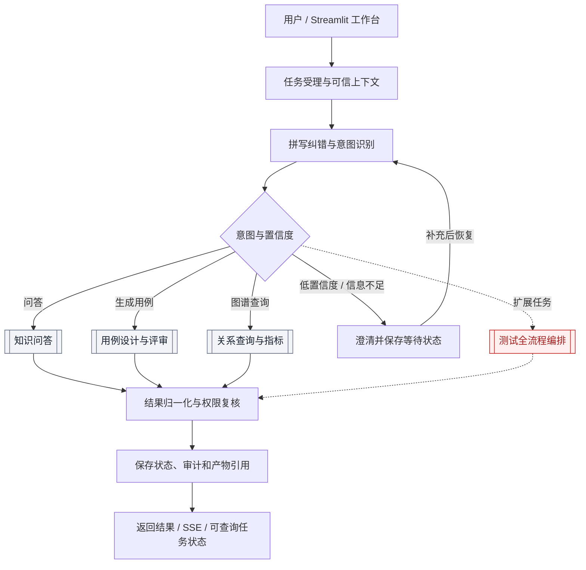

`DialogueState`、`CaseState`、`GraphQueryState` 隔离子图内部状态。主图只接收业务结果、引用和状态；共享 RAG 的结果返回调用它的子图，不触发重新路由。指代消解只在知识问答入口执行。所有拒绝、失败和取消都以明确状态汇入结果出口，不能被包装成成功。

### 2.2 测试全流程编排：目标子图关系

以下子图均暂缓。独立请求可从条件分派直接进入对应子图；已批准的业务产物也可通过条件边进入后续子图。边上的条件表示版本、授权和审批复核，不能理解为自动执行授权。

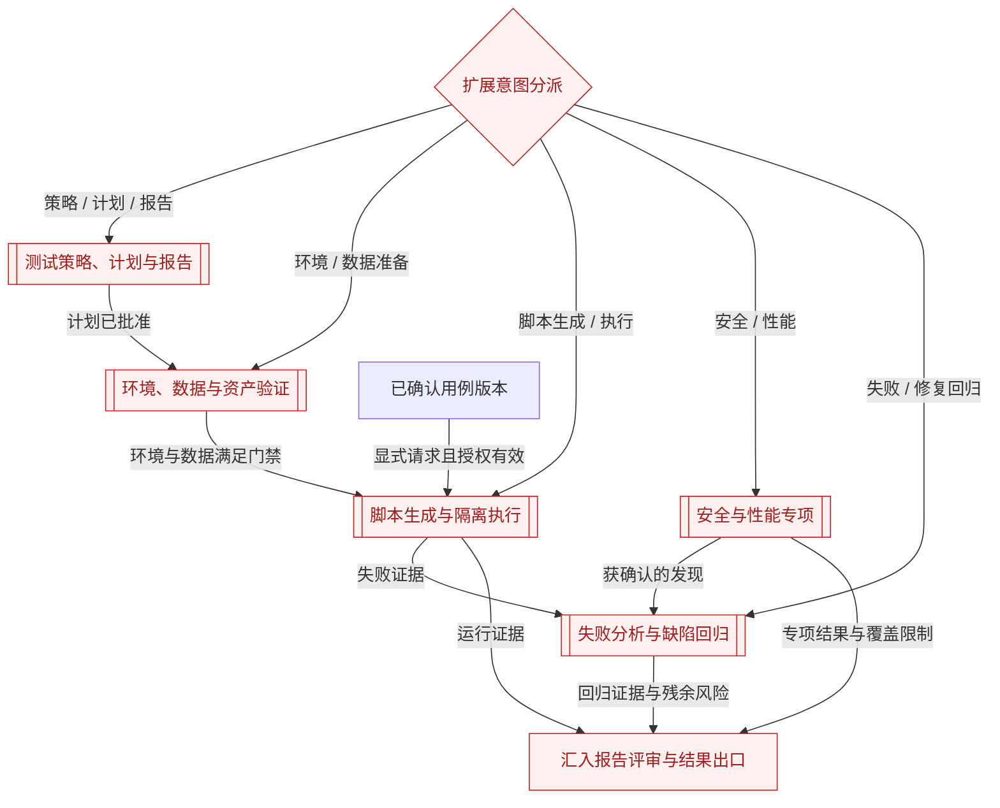

性能与安全在详细图中分别展开；获批性能环境、负载范围与安全测试资产范围使用不同契约。报告评审复用策略与计划子图的报告阶段。

### 2.3 知识问答子图

功能：技术直接问答或授权知识问答。输入为规范化问题、历史和 `answer_mode`；输出为回答、引用、证据不足标记和状态。

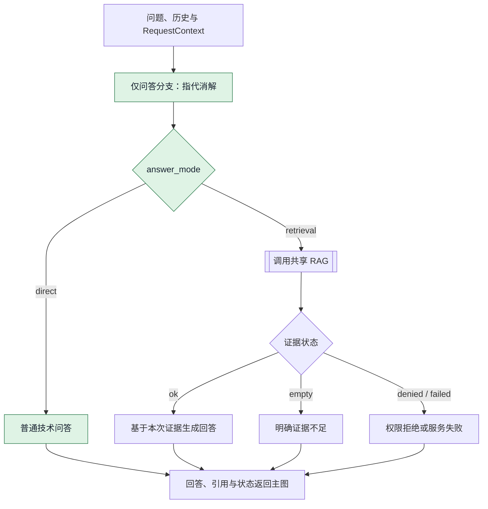

无历史、无指代或模型异常时，指代消解回退到 `corrected_query`。直接回答不伪造知识引用；权限拒绝不通过直接问答绕过授权。

### 2.4 共享 RAG 检索子图

功能：检索并封装证据，不生成业务答案。问答以及后续用例、脚本子图按需调用；返回值仅归属本次调用方。

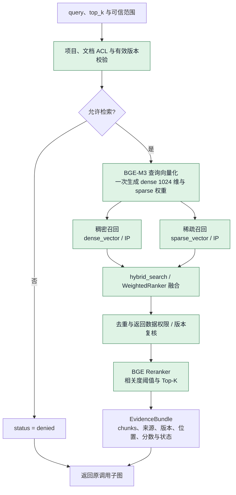

两路召回是同次混合检索的逻辑分支，不要求两次独立 API 调用。两路均使用授权项目和 PostgreSQL 有效版本范围；BGE-M3 稀疏权重不等同于 BM25。无候选返回 `empty`，模型或检索服务异常返回 `failed`；`EvidenceBundle` 出口及整条业务接入仍需验证，不能因底层检索节点绿色而整体标绿。

### 2.5 用例设计与评审子图

功能：从授权来源形成可追溯的用例草稿，经人工评审后受控写入禅道。当前交付路径到真实 `zentao_case_id` 即可返回。

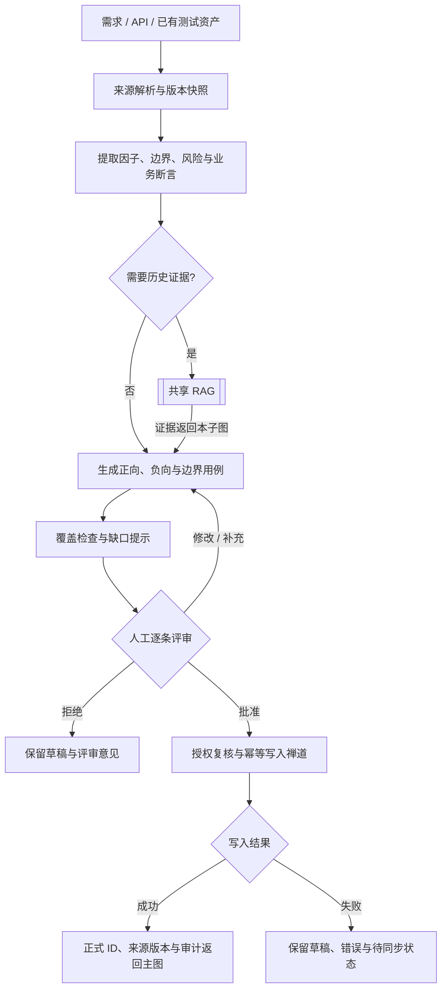

主图中这条完整链路尚未标为已实现。共享 RAG 失败须明确展示，不能用模型补全伪装成检索证据；后续脚本生成只有显式请求且权限与版本有效时才进入。

### 2.6 关系查询与指标子图

功能：对授权项目执行受控只读图谱查询，返回实体关系、进度或指标及其来源口径。

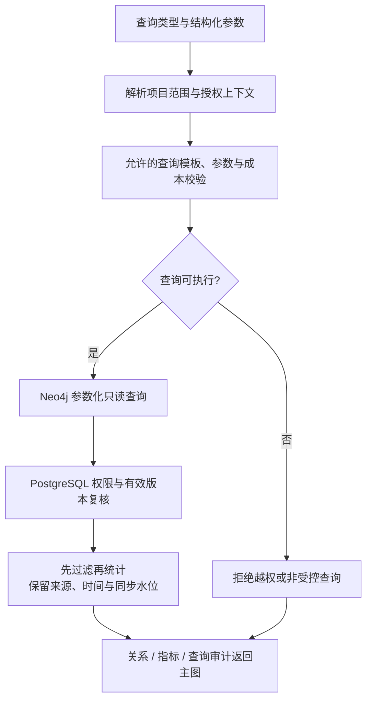

不执行模型生成的任意 Cypher。同步滞后、无数据、权限拒绝与查询失败需分别显示；Neo4j 是查询投影，不替代业务事实源。

### 2.7 测试策略、计划与报告子图（暂缓）

功能：将测试目标、风险、范围与资源形成获批计划，并基于真实执行证据生成和发布报告。

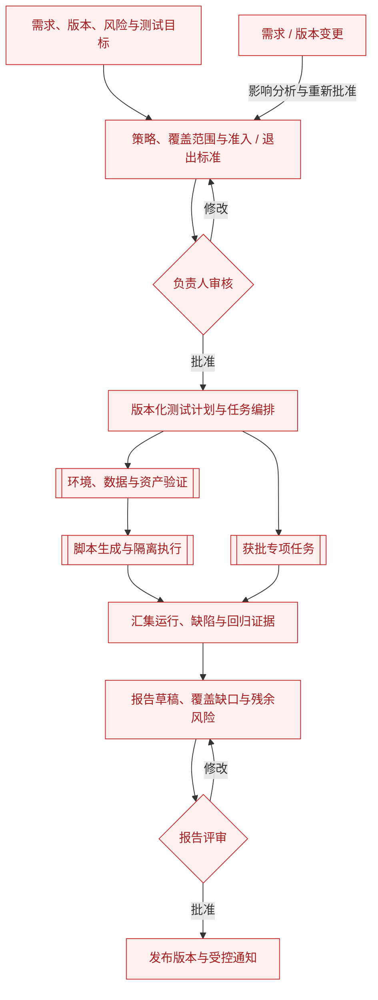

对应 F-39、F-40、F-46、F-50；风险追踪、组合覆盖与重复检查作为计划和用例评审的扩展。未采集指标和未执行任务不得在报告中标为通过。

### 2.8 环境、数据与资产验证子图（暂缓）

功能：准备授权环境和隔离测试数据，验证用例 / 脚本可执行性；自愈仅作用于受控 UI 定位器。

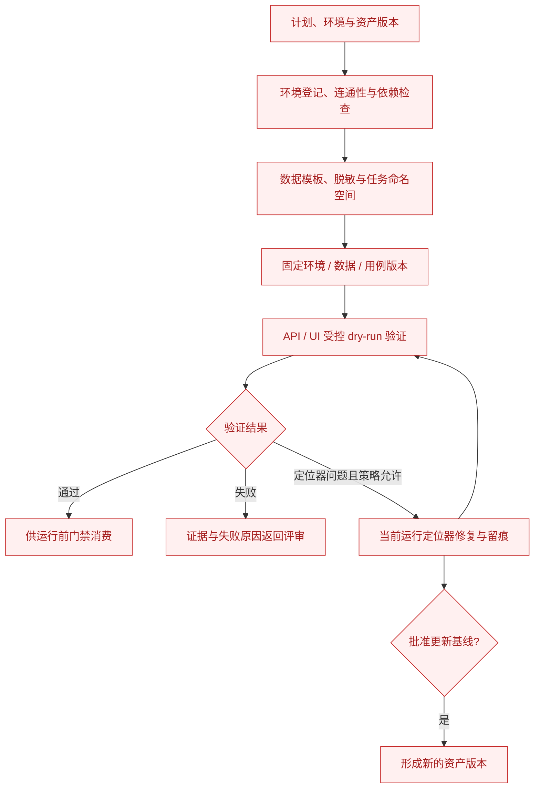

对应 F-41、F-42、F-43、F-46、F-47、F-48。禁止通过修改业务断言、预期或 API 参数制造通过；定位器修复不自动更新基线。

### 2.9 脚本生成与隔离执行子图（暂缓）

功能：将已确认用例转成受控脚本，经静态校验和人工审批后执行，输出真实运行证据。

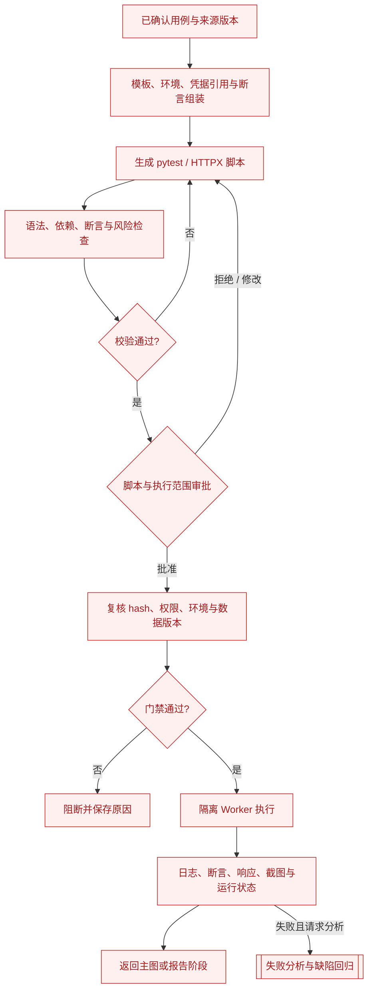

对应 F-14 至 F-19、F-45、F-46。修改脚本使原审批失效；调度器只能提交获批任务，执行时仍需复核。日志写入或通知失败不能触发重复执行。

### 2.10 安全测试与漏洞处置子图（暂缓）

功能：在明确授权范围内派发安全测试，保留发现的验证等级、覆盖限制和复测证据。

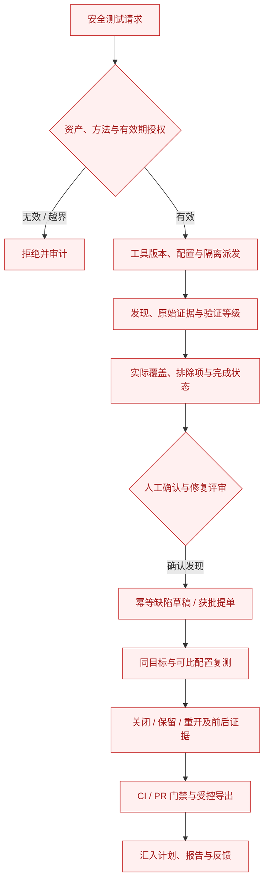

对应 F-30、F-33 至 F-38。模型推断不等于已验证漏洞；无发现、未完成、不可达或预算耗尽不等于安全通过。安全复测不替代功能回归。

### 2.11 性能测试子图（暂缓）

功能：在获批环境和负载预算内执行性能任务，保留工具原始报告及采集口径。

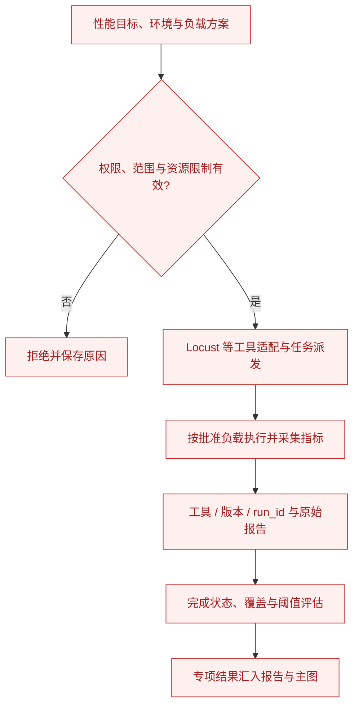

对应 F-16、F-30。性能阈值需按环境与基准测试确定；未运行显示未采集，未完整执行不能报告通过。

### 2.12 失败分析与缺陷回归子图（暂缓）

功能：把失败证据转成可审查的缺陷和修复回归闭环，保留未覆盖项及残余风险。

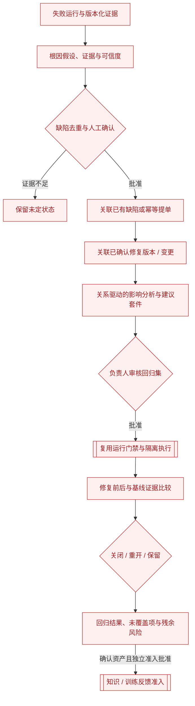

对应 F-18 至 F-21、F-26、F-45、F-49。回归集审批不替代执行授权；未执行或部分失败不得标为回归通过。

### 2.13 知识入库、版本维护与质量准入工作流

独立后台工作流，功能是把授权资料变成可检索的版本。手动入口与自动事件先登记持久化作业，再由 Knowledge Worker 处理，不占用每次用户问答的同步主路径。

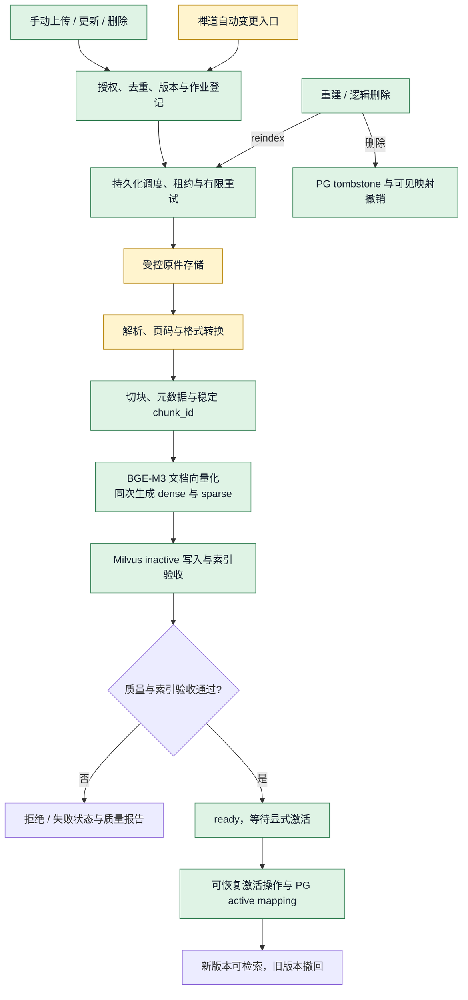

对应 F-04、F-05、F-06、F-27。自动入口真实禅道契约与自动入库闭环、OCR / 图片提取、解析隔离、物理回收和周期对账仍有缺口。反馈资产的知识准入与训练准入独立审批；删除先撤销可见性，不能等待物理清理后才阻止召回。

### 2.14 关系同步与维护工作流

独立后台工作流，功能是把外部事实和 TestMind 权威资产转为可重建的 Neo4j 查询投影。具体节点状态沿用主图，不因采用 Worker 设计而宣称整条集成闭环完成。

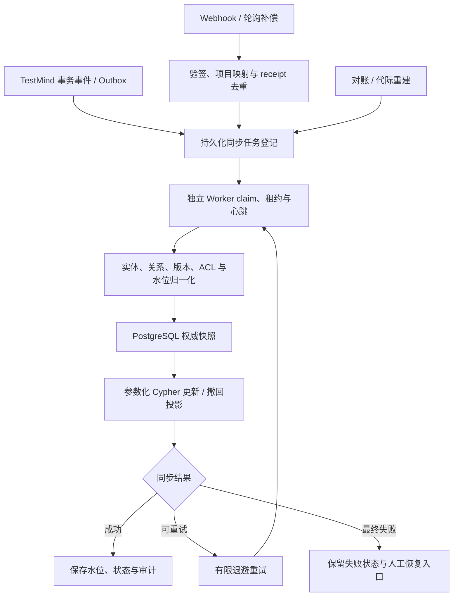

对应 F-27、F-28。外部 ID、删除标记与权限变更必须传播；同步失败不改变权威数据，查询需显示投影水位并再次复核权限。

### 2.15 反馈准入与模型治理工作流（暂缓）

独立治理工作流，功能是把获确认反馈转成受控知识或训练候选，经过独立评估后发布可回滚版本。

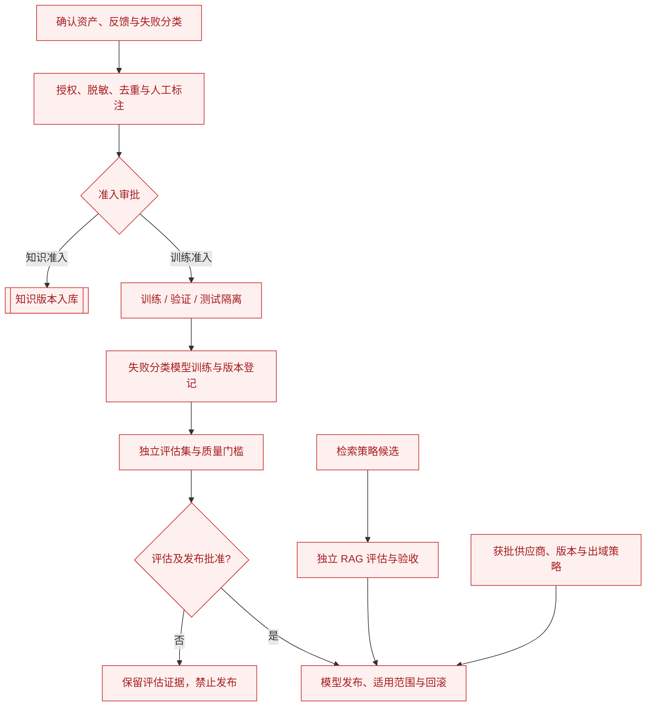

对应 F-06、F-20 至 F-23、F-44。新反馈不自动替换模型；知识准入不授权训练。管理控制台、模型 / Prompt 版本发布、评估和回滚均属于目标能力。

### 2.16 自动调度与报告通知工作流（暂缓）

独立调度工作流，功能是触发已批准任务以及同步获批报告；通知失败独立恢复。

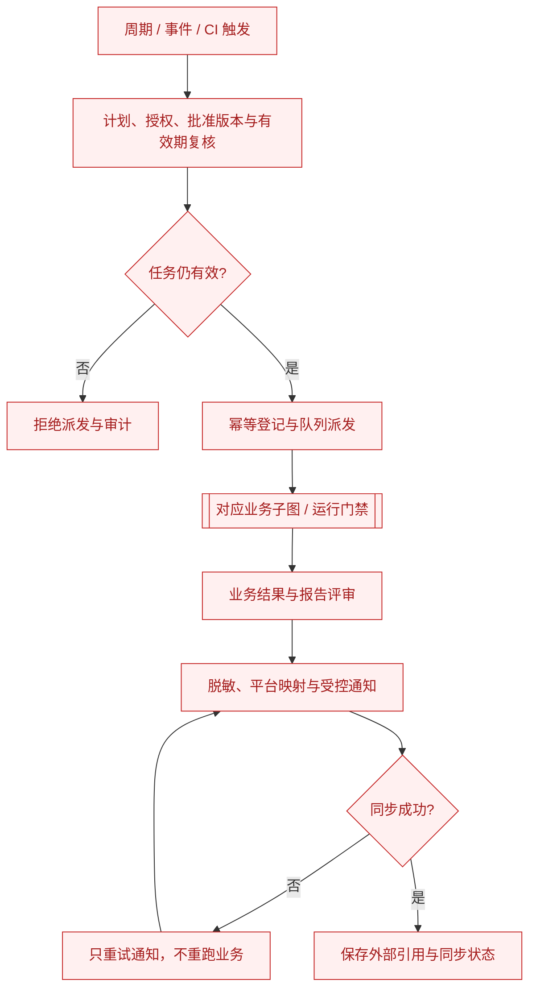

对应 F-24、F-25、F-38、F-46。手动任务不依赖定时调度，调度不等于新审批。

### 2.17 横切能力与基础设施

横切能力面向所有业务子图、API 和后台 Worker，不串入业务执行顺序。以下六层按主图统一标红，表示完整企业能力层暂缓交付；其中已有的鉴权、审计、幂等和重试等基础机制不因此被删除或降为未实现。

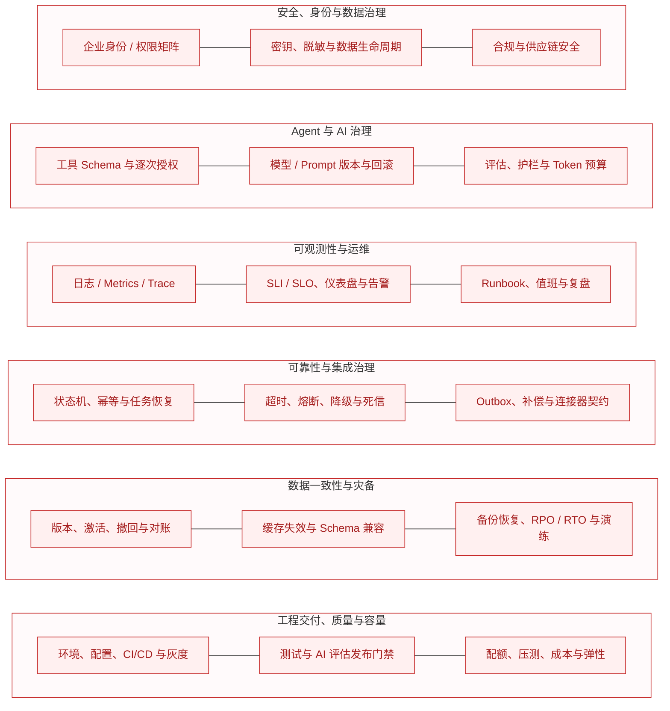

上图无向横线表示同层能力并列，隐藏连线仅用于纵向排版。专用 MQ、Kubernetes、配置中心、KMS / Vault 等组件按部署需求选用，不作为 MVP 的默认依赖。

| 基础设施 | 职责与数据边界 |
|---|---|
| FastAPI / Streamlit | 服务端任务与权限入口 / 用户工作台，不允许前端直连数据库 |
| LangGraph / Checkpoint | 主图与子图状态、澄清或审批暂停恢复；不承担知识与关系同步 Worker 调度 |
| PostgreSQL | 任务、来源、资产版本、审批、审计、作业、Outbox 与有效版本映射 |
| Milvus | dense / sparse 检索索引，权限与可见版本以服务端和 PG 为准 |
| Neo4j | 可重建的关系查询投影，外部系统及 PG 保留各自权威事实 |
| 受控文件存储 / MinIO | 原件与执行证据，使用项目权限和受控访问引用 |
| Redis（可选） | 缓存与临时状态，不作为业务事实或持久化作业的唯一存储 |
| JEV / 获批 LLM / 本地 BGE | 意图、生成、向量化与重排，遵守版本、权限与数据出域策略 |

`docs/diagrams/TestMind-单页完整流程.drawio` 与 `docs/diagrams/TestMind-单页完整流程.mmd` 并列作为主图：前者支持手动编辑布局，后者基于本节功能流程形成一张完整单图。业务流程、条件边、交付范围或实现状态变更时，同步两份主图及本节；布局坐标无须一致，渲染产物不能替代可编辑源文件。四类独立后台工作流分别按自身 API、事件或调度入口运行，不与用户请求的主路径串成一条同步链路。

## 3. 主图与状态边界

### 3.1 主图 `GraphState`

主图只保存编排所需的最小字段：

```text
raw_query / corrected_query / resolved_query
intent / answer_mode / confidence
task_id / trace_id / user_id / project_id / session_id
pending_clarification / status / last_error
agent_result / citations / asset_refs
```

`RequestContext` 通过 LangGraph context 注入可信身份和授权范围。客户端提交的项目或用户参数只作为请求候选值，服务端必须重新解析和校验。

**2026-10-13 已实现切片：**`/chat` 调用 `services/request_context.py`，根据 `AuthContext` 的授权知识库筛选当前项目，再通过 `KnowledgeRepository.build_retrieval_scope` 读取 PG 有效文档/索引版本映射。范围通过运行时 context 传入主图和问答子图，不写入 GraphState；客户端仍不能提交身份或检索范围。问答子图复核项目、知识库、文档版本和索引版本，现代 `active_versions` 存在时不回退旧 `document_versions`。

未授权范围返回 403；数据库失败或范围装配超时返回 503，不使用旧注入范围继续检索。有授权知识库但无有效版本时返回证据不足，无授权资料时要求补充范围；均不扩大为全库检索。无项目问答不查知识仓库。为兼容旧部署，仅在未配置仓库且已有经过校验的服务端注入范围时保留该路径；配置仓库后必须刷新范围。

本切片通过替身仓库/模型与真实 LangGraph 的单元测试；真实身份接入、即时撤权、真实 PG/Milvus/模型联调以及共享 RAG 子图完整封装仍待验收。带项目的请求在意图识别前装配范围，因而该项目的普通问答也会受仓库不可用影响，后续可在保持授权前置的基础上分离检索范围的延迟加载。

### 3.2 DialogueState

问答子图接收规范化问题、对话历史和 `answer_mode`。`direct` 进入普通技术问答，`retrieval` 调用共享 RAG。问答子图输出 `answer`、`citations`、`insufficient_evidence` 和状态；`retrieved_chunks`、ACL 过滤细节和检索追踪信息不回传主图。

### 3.3 RetrievalState 与 `EvidenceBundle`

共享 RAG 不是 Agent，也不负责决定业务分支或生成最终答案。输入包括查询、Top-K、检索策略和 `RequestContext`；输出包括：

```json
{
  "status": "ok | empty | denied | failed",
  "chunks": [
    {"chunk_id": "...", "text": "...", "source_id": "...", "version": "...", "page": 1, "score": 0.91}
  ],
  "trace_id": "...",
  "error": null
}
```

`denied`、`empty` 和 `failed` 必须区分。用例生成和脚本生成未来可以消费同一个 `EvidenceBundle`，但当前脚本子图不进入交付主路径。

### 3.4 CaseState

用例生成子图按以下阶段运行：来源选择与版本快照、测试因子提取、正向/负向/边界用例草稿、覆盖检查、人工逐条评审、受控写入禅道。成功写入必须保存外部 `zentao_case_id`、来源版本、审批版本和幂等键；写入失败保留草稿和错误，不得标记为已发布。

### 3.5 GraphQueryState

图谱查询只接受受控查询类型和结构化参数，拒绝模型生成的任意 Cypher。执行顺序为：身份与项目范围过滤 → 查询成本/参数校验 → Neo4j 只读投影查询 → PostgreSQL 权限复核 → 指标和审计结果返回。

### 3.6 暂缓的脚本状态

已确认用例可以关联脚本生成入口，但当前 `ScriptState`、脚本审批、环境门禁、隔离 Worker、运行报告和失败提单全部是暂缓路径。后续启用时必须复核用例版本、脚本内容 hash、环境、数据集、资源限制和审批人，修改脚本后原审批自动失效。

## 4. 模块设计

| 模块 | 当前职责 | 主要实现位置 |
|---|---|---|
| API 与任务入口 | 鉴权、任务受理、SSE/状态查询、知识/图谱/用例接口 | `src/testmind/api/`、`src/testmind/main.py` |
| 主图编排 | 拼写纠错、意图识别、指代消解、澄清、按 intent 路由 | `src/testmind/orchestration/` |
| 问答子图 | direct/retrieval 路由、普通问答、证据回答 | `src/testmind/workflows/dialogue.py` |
| 共享 RAG | 文档切分、BGE-M3 dense/sparse、Milvus hybrid search、重排、证据封装 | `src/testmind/infrastructure/knowledge/`、`src/testmind/infrastructure/milvus/` |
| 用例生成 | 来源快照、因子提取、用例生成、评审、禅道写入 | `src/testmind/api/test_cases.py`、`src/testmind/agents/`、`src/testmind/models/` |
| 图谱查询 | 受控参数查询、权限过滤、指标和查询审计 | `src/testmind/api/graph_query.py`、`src/testmind/infrastructure/graph_sync/query.py` |
| 知识后台 | ingest/reindex/activate、质量校验、版本激活与撤回 | `src/testmind/worker/knowledge_worker.py`、`src/testmind/infrastructure/knowledge/` |
| 关系同步后台 | Webhook、轮询补偿、实体归一化、关系投影、重试和对账 | `src/testmind/worker/graph_sync_worker.py`、`src/testmind/infrastructure/graph_sync/` |
| 持久化 | 任务、审批、来源、版本、审计、Outbox、同步水位 | PostgreSQL repositories、Alembic migrations |
| 暂缓执行链路 | 脚本生成、审批、隔离执行、运行报告、缺陷回归 | 图中红色 ScriptState 路径；当前不作为前置依赖 |

## 5. 数据模型

### 5.1 知识文档与版本

文档、版本、解析作业、质量报告、激活操作和审计记录存 PostgreSQL；原件存受控文件系统或 MinIO；向量以稳定 `chunk_id` 写入 Milvus。可见版本由 PostgreSQL active mapping 决定，Milvus 的 `is_active` 不能单独作为权限依据。

```text
KnowledgeDocument(id, project_id, source, title, created_by, status)
KnowledgeVersion(id, document_id, version, content_hash, parser_version, status)
KnowledgeChunk(chunk_id, version_id, text, page, offsets, acl, is_active)
IngestionJob(id, version_id, kind, lease, retry_count, status, last_error)
ActivationOperation(id, version_id, previous_version_id, status, audit_ref)
```

### 5.2 用例、审批与外部引用

```json
{
  "case_id": "internal-id",
  "project_id": "project-1",
  "source_refs": [{"source_id": "REQ-1", "version": "v3", "location": "section 2"}],
  "type": "positive | negative | boundary | exception",
  "preconditions": [],
  "steps": [],
  "expected": [],
  "risk": "medium",
  "review": {"state": "draft | approved | rejected", "reviewer_id": null},
  "external_refs": {"zentao_case_id": null},
  "idempotency_key": "project:source_hash:case_hash"
}
```

### 5.3 任务、审计和同步

```text
Task(task_id, user_id, project_id, session_id, intent, status, trace_id, last_error)
Approval(id, task_id, asset_type, content_hash, reviewer_id, decision, decided_at)
AuditEvent(id, actor, project_id, action, resource_ref, result, created_at)
GraphSyncEvent(id, source_instance, event_id, source_version, operation, status)
GraphSyncJob(id, watermark, lease_token, retry_count, status, error)
```

Neo4j 只保存可重建的关系查询投影；PostgreSQL 保存外部来源、权限映射、版本水位和同步事实。撤权时查询入口必须再次检查 PostgreSQL 权限，即使图谱副本尚未完成失效处理。

## 6. 接口契约

| 能力 | 接口 | 说明 |
|---|---|---|
| 任务提交 | `POST /api/v1/tasks` | 创建任务，返回 `task_id`、`trace_id`、意图初始状态和待补信息 |
| 任务状态 | `GET /api/v1/tasks/{id}` | 返回持久化状态、结果引用和最终错误 |
| 任务事件 | `GET /api/v1/tasks/{id}/events` | SSE 短反馈；通知补发不得重复执行任务 |
| 知识上传 | `POST /api/v1/knowledge-bases/{kb_id}/documents` | 返回 document/version/job ID；权限、类型、大小和签名先校验 |
| 知识维护 | `PATCH/DELETE /api/v1/knowledge-bases/{kb_id}/documents/{id}` | 新版本、逻辑删除、reindex，失败可恢复 |
| 图谱查询 | `GET /api/v1/graph/query`；`POST /api/v1/tasks` 统一入口 | 受限 DTO 与主图 GraphQueryNode；权限/PG 事实复核，拒绝任意 Cypher |
| 图谱指标 | `GET /api/v1/metrics` | 仅返回当前授权范围，标注统计口径和时间范围 |
| 图谱事件 | `POST /api/v1/graph/events` | TestMind 事务 Outbox 事件，幂等登记后异步投影 |
| 用例生成 | `POST /api/v1/test-cases/generate` | 返回待审草稿、覆盖缺口和来源引用 |
| 审批决定 | `POST /api/v1/approvals/{id}/decision` | 接受、修改、拒绝；版本/hash 变化使旧决定失效 |
| 禅道写入 | `POST /api/v1/integrations/zentao/test-cases` | 仅批准版本可写；幂等返回正式 ID 或错误 |

所有写接口都记录操作者、项目、来源版本、内容 hash、幂等键和审计结果。脚本运行接口目前只在红色暂缓路径中保留设计位置，不能作为当前完成能力调用。

## 7. 关键时序

### 7.1 主图入口与问答/RAG

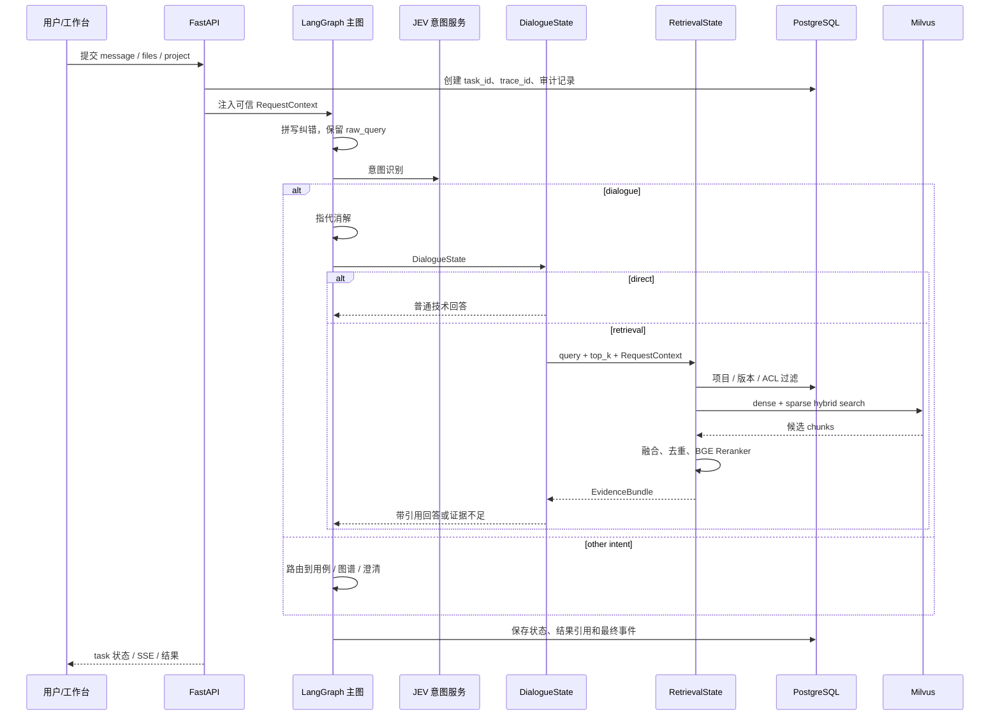

### 7.2 用例生成与禅道写入

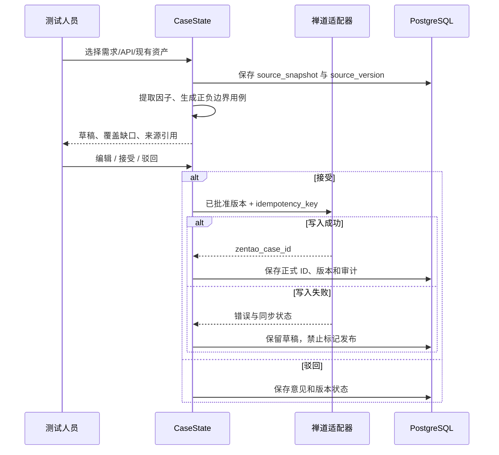

### 7.3 知识入库后台

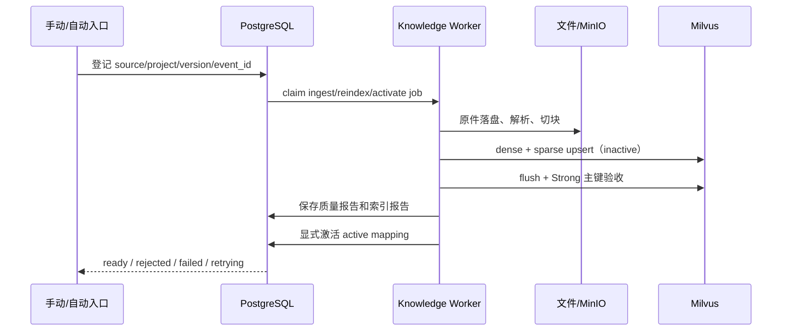

### 7.4 关系同步后台

```mermaid
sequenceDiagram
    participant Z as 禅道/标准网关
    participant API as Webhook/轮询入口
    participant PG as PostgreSQL 权威资产
    participant W as Graph Sync Worker
    participant N as Neo4j 投影
    Z->>API: 签名事件或增量数据
    API->>PG: 验签、项目映射、receipt 幂等登记
    PG->>W: claim 同步任务
    W->>PG: 归一化实体、版本、水位和权限映射
    W->>N: 参数化 Cypher 投影 / 撤回
    N-->>W: 投影结果
    W->>PG: 成功、重试或最终失败
    PG-->>W: 对账 / 代际重建任务
```

## 8. 技术选型

| 层 | 当前选型 | 设计说明 |
|---|---|---|
| 前端 | Streamlit | 工作台、知识问答、用例/图谱操作和状态查看；不直连数据库 |
| API | FastAPI + Uvicorn + Pydantic | 任务、知识、图谱、审批、集成和状态接口；服务端完成授权 |
| 编排 | LangGraph + LangChain | 主图状态、问答子图、人工澄清和可恢复 checkpoint |
| 意图识别 | JEV 模型服务 | 可替换；低置信度或异常进入澄清，不成为权限边界 |
| 大模型 | DeepSeek API / OpenAI 兼容接口 | 问答、因子提取、用例草稿和分析辅助；遵守数据出域策略 |
| 文档解析 | pypdf + LangChain Text Splitters | PDF/Markdown/TXT 解析、切块、页码和来源位置保留 |
| Embedding | 本地 BGE-M3 | 同次生成 dense 与 sparse；模型不隐式下载 |
| 重排 | BGE Reranker | 本地重排，配合 Top-K、相关度阈值和证据状态 |
| 向量检索 | Milvus + BM25 能力 | dense/sparse 混合召回；项目 ACL 和 active version 先过滤 |
| 关系数据 | PostgreSQL + SQLAlchemy + Alembic | 任务、资产、版本、审批、审计、Outbox、同步状态 |
| 图谱 | Neo4j | 测试资产关系查询投影，可由 PostgreSQL 权威快照重建 |
| 缓存/临时状态 | Redis（可选） | 只用于缓存、锁和临时队列；不可代替 PostgreSQL 事实源 |
| 文件存储 | 本地文件系统 / MinIO | 原件、脚本、日志、截图和报告；按项目和权限隔离 |
| 测试验证 | pytest、pytest-asyncio、HTTPX | 产品单元/集成测试和 HTTP 接口测试 |
| 外部集成 | 禅道、OpenAPI/Postman、代码托管/CI、飞书/Lark | 通过适配器接入，记录外部 ID、版本、重试和同步状态 |
| 暂缓执行 | Playwright/Selenium、Locust、OWASP ZAP | 主图保留红色扩展路径，当前不作为核心依赖 |

## 9. 安全、可靠性与可观测性

- **权限：**每个入口先解析服务端身份和项目成员关系，再读取知识、图谱或资产；聚合统计前先做范围过滤，撤权后再次复核。
- **数据保护：**提示词、日志、截图和响应按项目与敏感级别最小化；外部模型调用记录供应商、模型版本和接收方；密钥只存密钥服务或环境引用。
- **幂等：**知识文档按项目/内容 hash/版本登记；禅道写入使用项目隔离的幂等键；Webhook 使用 event_id/receipt；同步水位失败不前进。
- **任务恢复：**长任务保存 checkpoint、lease、retry_count、last_error 和最终状态；页面刷新或 Worker 重启后可以继续查询或恢复。
- **索引一致性：**先写 inactive 向量并进行 flush/Strong 验收，再通过 PostgreSQL active mapping 显式激活；撤回先撤销可见映射。
- **审计：**记录上传、检索、生成、审批、外部写入、权限变化、同步、对账和导出；审计记录包含 actor、project、resource、version、hash、结果和时间。
- **观测：**所有任务携带 `task_id`/`trace_id`；结构化记录阶段、耗时、模型调用、检索命中、外部 ID 和失败类别。生产告警、独立死信平台和定期 GC 属于后续运维能力。

## 10. 目录结构与实现映射

```text
src/testmind/
├── api/                         # chat/tasks/knowledge/test_cases/graph/runs/approvals
├── agents/                      # 用例与资产生成能力
├── core/                        # 配置、权限、基础运行时
├── infrastructure/
│   ├── knowledge/               # 解析、切块、质量、激活
│   ├── milvus/                  # 检索与向量访问
│   ├── graph_sync/              # 禅道/标准网关、投影、对账
│   ├── llm/                     # 模型适配
│   └── postgres/                # 业务事实与同步仓储
├── orchestration/               # 主图 State、节点、路由
├── workflows/dialogue.py        # 问答子图
├── worker/                      # knowledge_worker / graph_sync_worker
├── models/                      # domain / request / result models
└── prompts/                     # 纠错、问答和生成提示词
```

## 11. 验证策略

### 11.1 2026-10-14 本地 P0/P1 实现契约

- 配置 `deploy/demo.env`；统一 `testmind` Compose 项目，PG 15432、Milvus 29530/29091、Neo4j 17474/17687 仅监听 loopback；etcd/MinIO 仅内部通信。数据是可回收演示数据。
- `X-Demo-User` 只用于 development 的 `DemoAuthorizationProvider`，每次从 PG `business.demo_users/demo_grants` 复核；演示模式不读取个人 `.env`。两用户/两项目/两知识库由 `scripts/init_demo.py` 建立，企业身份未接入。
- `TaskSubmission` 是 query/project_id/session_id；身份不允许从 JSON 自授。幂等按 user/project/key + 输入指纹，变化返回 409。`resume` 提交完整澄清后的问题和 expected_version，不是任意状态重试接口。
- `business.tasks/task_events/approvals/external_operations/conversation_turns` 独立于 LangGraph Checkpoint；事务事件按 task/seq，租约 claim token 拒绝过期写回；每任务稳定 execution_thread_id。外部账本先冻结存储契约，未启用外部操作。
- Worker 最多 3 次执行、单次 60 秒，累计 180 秒截止时间存 PG 并跨重启复用；澄清新输入版本重置预算。取消和执行期间撤权会取消图任务。会话历史按 user/project/session 加载，重入清空旧图消息后装配本次有界历史。
- SSE 只订阅持久化事件，Last-Event-ID 补读不执行图；等待状态保持订阅，终态结束。API 和 Worker 用 `scripts/run_demo.py api/worker` 分进程启动，`scripts/smoke_demo.py` 实际终止/重启进程验证恢复。
- 所有 BaseNode 与问答子图入口限制输入/状态/输出并设置超时，结构化开始/停止事件携带 task/trace/attempt。纯模型调用分别预算瞬时重试 2 次与输出修复 1 次，脱敏反馈不含原始异常。字符预算保守上界，不宣称精确 Token/计费。
- 只读节点复用 `create_zentao_tools`：PG 授权→固定 ToolProposal→每次 RPC 前后复核、3 次 RPC/10 秒单次超时/输出字段校验；离线 proposer 和 Caller 用于答辩，真实传输尚未在聊天启用。模型不能选择项目授权，返回内容只保留 id/name/title/status。
- 审批基础测试资产 version/hash 绑定、拒绝过期/重复决定、内容修改失效；完整用例审批恢复和禅道写入继续按 P3 接入。API 原有 `/chat` 保持兼容，但恢复承诺属于任务 API。
- `/health` 存活、`/ready` 本链路 PG/迁移/图就绪；单进程任务/聊天 8 并发、每来源 120 次/分钟。CI 单元/定向 Ruff/Mypy，实依赖检查 `scripts/check_demo.ps1`。不记录隐藏思维链、Prompt、完整工具输出及答案正文。

当前证据与审查见 `docs/SOP/P0-P1-本地演示验收-2026-10-14.md`。本节覆盖先前“必须真实身份才能继续”的答辩范围门槛，其余生产目标保留。

| 验证对象 | 最低检查 |
|---|---|
| 主图 | 拼写纠错 → 意图识别 → 路由；dialogue 才调用指代消解；低置信度进入澄清 |
| 问答/RAG | direct/retrieval 路由；授权、版本过滤；EvidenceBundle 引用；empty/denied/failed 分离 |
| 用例 | 正向/负向/边界；来源与版本保留；人工评审；禅道写入成功返回正式 ID，失败保留草稿 |
| 图谱 | 受限查询拒绝任意 Cypher；先授权后统计；撤权后旧查询拒绝；来源和时间口径可追溯 |
| 知识后台 | 解析告警、质量门禁、inactive 索引验收、显式激活、撤回和重试恢复 |
| 关系同步 | HMAC/来源校验、receipt 幂等、水位补偿、版本门禁、参数化投影、对账重建 |
| 暂缓脚本链路 | 只验证边界和审批契约，不把未实现脚本执行标为当前通过 |

主图结构校验使用 `python tmp/verify_prd_mvp.py`；浏览器预览使用 `node tmp/preview_subgraphs_browser.cjs`。任何状态为“已完成”的节点，都需要对应代码、测试或运行证据，图中绿色只表达该节点的内部实现状态。
