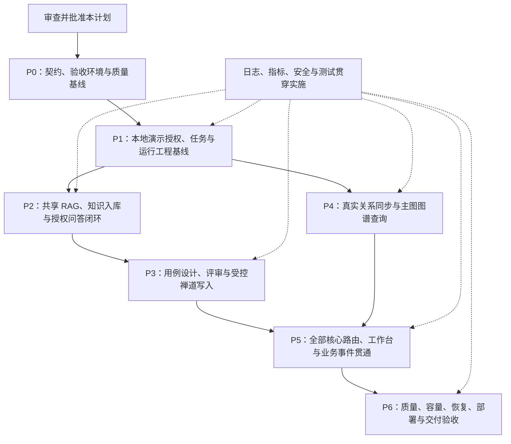

# TestMind 核心 MVP 总体实施与交付计划

> **For agentic workers:** 使用 `superpowers:executing-plans` 分阶段实施。任务使用 `- [ ]` 跟踪；仅在用户明确授权时使用子代理。本文件为总体计划，各工作包开工前补充任务级实施步骤。

**Goal:** 完成七条核心链路及必要工程基线，交付可部署、可恢复、可追溯、可验证的 TestMind 企业场景 MVP。

**Architecture:** FastAPI 统一受理可信身份和项目任务，LangGraph 编排问答、用例和图谱查询子图，共享 RAG 只返回证据。PostgreSQL 保存业务状态与权限/版本权威，知识 Worker 和关系同步 Worker 独立运行；Milvus 与 Neo4j 保存可重建投影。

**Tech Stack:** Python >=3.11、uv、FastAPI、Streamlit、LangGraph/LangChain、PostgreSQL/Alembic、Milvus、Neo4j、本地 BGE-M3/BGE Reranker、获批 LLM/JEV、禅道 MCP/API；依赖以现有 `pyproject.toml`、`uv.lock` 为准。

**Spec:** [PRD v2.0](../../02-产品需求文档PRD-v2.0.md)、[TDD](../../04-技术设计文档TDD.md)、[draw.io 主图](../../diagrams/TestMind-单页完整流程.drawio)、[Mermaid 主图](../../diagrams/TestMind-单页完整流程.mmd)、[当前范围](../../diagrams/TestMind-MVP范围说明.md)、[MCP 后续准备](../../SOP/MCP接入后续准备清单.md)。

| 项目 | 内容 |
|---|---|
| 计划状态 | 2026-10-14 P0～P6 本地演示切片已实施并验证；生产身份/外部集成不在此演示完成声明内。P5/P6 证据见第 13.8 节 |
| 编制日期 | 2026-10-13 |
| 代码基线 | 编制时单元基线 170 passed；第 13 节完成后记录为 202 passed，详见实施记录；后续代码变更需重新验证 |
| 证据边界 | 单元测试通过不代表真实身份、数据库、外部写入、端到端和生产验收通过 |
| 排期方式 | 先确认范围与阶段依赖，再根据任务级拆分排期；不沿用早期 7 天 Demo 排期 |
| 完成判定 | 以阶段验收和可复核证据为准，不能以图中节点存在或文件存在判定 |
| 2026-10-13 范围确认 | 用户已确认将框架调整纳入 P0/P1；总体计划其他审查项不据此自动视为已批准 |

## 1. 全局约束

- 当前执行授权：用户于 2026-10-14 明确要求在当前工作区依序完成 P0 与 P1，并于 P1 后审查；不因此授权提交、推送、合并、部署、对外发布或执行禅道写入。
- 延续已有模块、协议和 PostgreSQL 队列；已有实现优先补装配、联调和边界，不整体重写。
- 真实调用者身份、项目权限、知识库范围来自服务端；模型参数、客户端项目 ID、共享禅道连接账号均不授予用户权限。
- 知识可见版本以 PostgreSQL active mapping 为准；Neo4j 是关系查询投影，不能成为业务事实源。
- 问答指代消解只在 dialogue 分支执行；共享 RAG 不识别业务意图、不生成最终答案、不重新路由主图。
- 用例生成只形成草稿；人工批准、版本有效和写权限复核之后才能写入禅道。
- 外部写入结果不确定时不得盲目重试或标记成功；禁止承诺跨系统 exactly-once。
- 任务、审批、事件和投影均有版本、幂等、错误和恢复语义；等待人工操作不持续占用 Worker 租约。
- 不读取或输出真实密码、Cookie、Token；`.env` 和模型权重不进文档、日志或仓库。
- 使用 TestMind 专用开发/验收 Compose 项目、数据库、集合和图谱范围。2026-10-14 用户明确授权清理本地旧依赖容器，先核对名称/挂载再执行；不波及 Dify/n8n，不自动删除旧卷。
- 保留工作区现有未提交修改；本计划不授权提交、推送、合并或修改远程系统。
- `docs/` 当前被忽略，计划及架构文档保持本地；是否纳入版本管理需另行决定。
- 变更同步 PRD/TDD、两份主图和实现状态说明。完整横切层继续标红，不妨碍基础权限、日志、测试等具体能力交付。

## 2. 本期范围与交付边界

### 2.1 必须完成的七条核心链路

| 链路 | MVP 必须交付 | 对应范围 |
|---|---|---|
| 主图 | 可信入口、纠错、意图、按条件分派、澄清、任务状态、统一结果与恢复 | F-07～F-10、F-29 |
| 问答子图 | 指代消解、direct/retrieval、引用校验、证据不足/拒绝/失败区分 | F-07、F-08、F-29 |
| 用例设计子图 | 授权来源、版本快照、因子与正负边界用例、覆盖缺口、人工评审、真实禅道 ID | F-01～F-03、F-11～F-13、F-45 的用例评审部分 |
| 关系图谱查询子图 | 意图到受控参数、授权只读查询、当前资产关系与指标、来源/水位和审计 | F-28 的关系与当前指标部分 |
| 共享 RAG 子图 | 授权/有效版本范围、一次向量化、两路召回、融合/重排、EvidenceBundle 与调用方隔离 | F-06、F-07 |
| 向量化入库 | 手动与禅道来源变更、持久化任务、文本解析、切块、索引验收、激活、更新/撤回和恢复 | F-04～F-06、F-27 的知识来源部分 |
| 图谱化入库 | 来源增量/事件、幂等登记、实体关系归一化、PG 权威资产、Neo4j 投影、撤权/删除传播与对账 | F-27、F-28 的关系同步部分 |

“图谱化入库”具体指测试资产关系同步与投影；本期不新增通用文档实体抽取与开放域知识图谱引擎。关联 PRD 条目只验收本表列明的切片，不据此宣称该条目的全部扩展能力完成。

### 2.2 工程化必须同时交付

| 工程基线 | 最小交付 |
|---|---|
| 身份与安全 | 一个可信身份源、项目/知识库权限、服务身份与调用者隔离、撤权复核、敏感信息保护 |
| 状态与恢复 | 持久化任务、Checkpoint、审批、合法迁移、幂等、有限重试、失败分类与人工恢复入口 |
| 可观测性 | 关联结构化日志、技术指标、模型成本/耗时、Worker 积压与失败、关键告警 |
| AI 质量 | 版本化独立评估集、检索/引用/意图/用例质量检查、模型与 Prompt 版本记录 |
| 发布与部署 | 可复现运行环境、迁移、健康检查、进程管理、环境配置隔离、最小发布检查与回滚说明 |
| 测试与运维 | 核心 E2E、真实集成测试、隔离与恢复测试、备份恢复验证、Runbook 与负责角色 |

### 2.3 明确暂缓

- 脚本生成/审批/隔离执行、运行报告、主动安全/性能测试、UI 自愈与跨端执行。
- 全流程测试策略/计划、环境和数据管理平台、缺陷修复回归、全计划报告发布。
- 周期/事件/CI 业务调度平台、模型训练、反馈数据飞轮与模型管理控制台。
- 多供应商自动路由、Prompt A/B 平台、完整企业 SSO/IAM 管理平台、完整合规认证。
- Kafka/RabbitMQ、分库分表、Kubernetes HPA/VPA、专用配置中心等规模化组件。

既有 Worker 轮询、重试、增量同步和必要维护可以运行；它们不等于引入上述业务调度平台。

### 2.4 建议批准的范围收敛

1. 知识输入首期限定 PDF 文本、Markdown、TXT；OCR、图片提取和视觉检索保留部分实现标记，不作为本期必过项。文本解析必须有超时/大小/资源边界。
2. 图谱指标首期只验收当前授权资产与显式关系；复杂历史趋势、专项指标和预测暂缓。
3. 自动来源首期优先轮询增量与水位补偿；环境提供真实 Webhook 时再启用签名入口。标准网关占位接口不计作真实禅道闭环。
4. 清理、对账、失败恢复允许采用受控管理 API/命令；自动周期调度与独立死信控制台暂缓。
5. 最小部署采用一套开发环境和一套隔离验收环境；生产形态复用同一构建与配置约束，不以已部署生产环境作为既成事实。

以上是待审查的取舍，不自动扩大或缩小已批准范围。

## 3. 当前基线与复用策略

| 模块 | 当前核对结果 | 实施策略 |
|---|---|---|
| `orchestration/builder.py`、`routing.py` | 主图只接问答和澄清；其他意图转澄清 | 增量接入用例与图谱，保留暂缓分支的明确反馈 |
| `workflows/dialogue.py` | 直接/检索问答、超时与引用检查已有 | 复用生成与引用检查，替换为共享 RAG 契约消费 |
| `api/chat.py` | 可信身份契约与会话 hash 已有；读取 request.state 检索范围 | 接通身份与范围装配、任务入口，兼容已有聊天接口 |
| `models/retrieval.py`、Milvus retrieval | dense/sparse、重排、scope/chunk 模型已有 | 增加统一 EvidenceBundle，复用底层检索 |
| 用例 workflow/API、任务/审批 API | 当前为空文件 | 优先完整实现本期业务契约，避免创建只有名字的节点 |
| `graph_sync/query.py`、图谱 API/UI | 受控模板、权限复核、当前指标已有 | 接主图参数提取，完成身份来源和实库联调 |
| knowledge Worker/repository | ingest/reindex/activate、质量与激活已有 | 补自动来源、运行维护和真实测试 |
| graph sync Worker/repository | 登记、租约、投影、轮询、对账与重建已有 | 补真实来源和业务事件，不重建另一套同步系统 |
| 禅道 MCP | 七项只读、REST API 与工具工厂已有 | 复用读取；写接口单独白名单、权限、审批与对账 |
| 工程底座 | PG Checkpoint、锁定依赖、单元测试、日志和迁移已有 | 补统一业务状态、结构化观测、部署与发布门禁 |
| 集成/部署 | 知识集成测试为占位；Compose 为空 | 建真实验收运行器和可重复启动配置 |

已有质量/接口说明见 [禅道交接](../../SOP/禅道MCP能力交接记录-2026-10-13.md)、[知识启动验收](../../SOP/TestMind本地Docker与知识入库启动验收.md)。历史外部冒烟证据在实施时重新验证，不作为持续有效的上线证据。

## 4. 总体阶段与依赖

### 4.1 P0/P1 框架调整（已确认纳入）

保持现有技术栈，以模块化单体和独立 Worker 运行。框架调整与实际业务切片一起交付，不先搬迁全部目录或为暂缓能力创建空模块。

| 边界 | P0：确认职责和契约 | P1：随首条链路落地 |
|---|---|---|
| API 与业务服务 | API 负责传输、输入输出、身份依赖；services 负责用例/任务/审批等业务规则 | 从真实入口抽出服务；先建立请求上下文服务，避免权限判断散落各接口 |
| 主图与子图 | 主图负责路由/恢复/统一结果；子图有独立输入输出和内部状态 | 补主图结果/恢复契约；后续子图逐包装配，不让 GraphState 承载所有临时数据 |
| 身份与请求上下文 | 区分 AuthContext、RequestContext、RetrievalScope；明确调用者、项目/权限版本与 trace 的来源 | 服务端校验项目及知识库，装配有效版本检索范围；真实身份适配按 WP-03 完成 |
| 持久化与执行 | 任务/审批/事件为业务状态；Checkpoint 为图执行恢复；会话历史单独隔离 | 实现 WP-04/05 的持久化任务执行；复用现有 PG 作业模式 |
| 检索与入库 | 共享 RAG 返回证据，知识/图谱入库为独立后台工作流 | 保留现有 infrastructure 与两个 Worker；RAG 子图在 P2 接入 |
| 横切能力 | 配置、鉴权、日志、指标、预算和错误为公共能力；不串成业务节点 | 在 WP-06 随真实入口接入，保持可测试与失败边界；所有 AI 节点采用按能力分级的输入/输出/停止约束，只有可调用工具或产生副作用的节点强制执行三层授权/参数/结果校验 |

拟采用 `services/` 作为应用业务服务目录；现有 `models/`、`orchestration/`、`workflows/`、`infrastructure/` 和 `worker/` 延续职责。空的 `repositories/`、`integrations/` 等预留目录不触发已有实现的大规模搬迁，新增代码先选择唯一归属。RAG 与图谱查询不因名称而强制包装为 Agent。

### 4.2 阶段顺序



P4 可在 P1 后独立推进；若按单人顺序实施，默认 P0→P1→P2→P3→P4→P5→P6。P5 将已单独验收的链路组合，不允许把主图装配拖到最后才首次运行。每阶段结束必须留可运行切片和审查证据。

## 5. 统一契约与状态设计

本节是拟采用的实现约束，P0 冻结字段和 API 兼容方式。

### 5.1 请求、任务、会话与执行

- `RequestContext`：可信 `user_id/project_id`、角色/权限版本、授权知识库/检索范围、`trace_id`；工具每次调用重新复核授权。
- `Task`：`task_id`、创建者、项目、会话、意图、状态、输入版本、结果引用、错误、时间戳与幂等键。
- `task_id` 标识业务任务，`attempt_id` 标识一次执行，`event_id` 标识事件；不能用 trace ID 代替幂等键。
- 每任务使用稳定 `execution_thread_id` 恢复 Checkpoint；会话历史独立按用户/项目/session 隔离，仅问答按需加载，避免重跑新任务时覆盖旧任务状态。
- `task_events` 使用持久化有序事件序号；SSE 支持 `Last-Event-ID` 补读，断线只重订阅，不能重新启动业务。
- 通过现有 PG 租约作业模式执行后台主图任务；不引入独立 MQ，也不依赖 FastAPI 内存后台任务保证可恢复性。

### 5.2 合法任务迁移

```text
queued -> running
running -> waiting_input | waiting_review | completed | denied | failed | needs_reconciliation
waiting_input -> queued | cancelled
waiting_review -> queued | rejected | cancelled
failed -> queued（仅可重试分类、重试次数未超限且授权仍有效）
needs_reconciliation -> completed | failed | waiting_review（核实外部结果后）
queued/running -> cancelled（取消须处理外部结果已发生的情形）
```

终态不能被旧租约覆盖；取消正在发生的外部写入时先记录取消请求，核实实际结果后确定终态。状态更新与事件写入处于同一事务；审批恢复不持有长期执行锁。

### 5.3 子图结果与证据

- 主图统一结果：`status`、`answer/summary`、`citations`、`asset_refs`、`error` 和 `trace_id`。
- `EvidenceBundle`：`ok/empty/denied/failed`、chunks、来源/有效版本/位置/分数、错误码与调用标识。内部 ACL、模型凭据和原件路径不回传客户端。
- RAG 的 `empty` 可明确提示证据不足；`denied` 不降级为越权查询；`failed` 不能伪装成空结果。
- 用例草稿必须有来源快照、步骤、预期/断言、风险、覆盖映射、内容 hash 与草稿版本。
- `Approval` 绑定任务、项目、资产版本/hash、评审者与决定；内容或来源版本改变时审批失效。

### 5.4 核心接口

| 接口 | MVP 行为 |
|---|---|
| `POST /api/v1/tasks` | 授权、项目隔离幂等、持久化任务；202 返回 task/trace ID |
| `GET /api/v1/tasks/{id}` | 当前权限复核后读取状态/结果；禁止通过 ID 枚举跨用户或跨项目读取 |
| `GET /api/v1/tasks/{id}/events` | 受控 SSE、事件补读、重连不重跑 |
| `POST /api/v1/tasks/{id}/resume` | 复核身份、版本与合法等待状态，补充输入后恢复 |
| `POST /api/v1/tasks/{id}/cancel` | 取消请求和实际终态分离，外部写入进行中不误报取消成功 |
| `POST /api/v1/test-cases/generate` | 复用任务受理与用例子图，返回草稿任务引用 |
| `POST /api/v1/approvals/{id}/decision` | 批准/修改/拒绝；拒绝过期版本与权限不足的决定 |
| `POST /api/v1/integrations/zentao/test-cases` | 仅批准版本、真实写权限与独立幂等账本；成功返回正式 ID |
| 现有 chat、知识、图谱接口 | 保持兼容，复用相同授权、错误和审计契约；禁止出现两套权限判断 |

新增 resume/cancel 属于本计划提出的接口补充，批准后同步 TDD 第 6 节。

## 6. 工作包与阶段验收

### P0：冻结契约、环境与基线

**依赖：**用户批准总体范围及第 2.4 节取舍。

- [x] **WP-01 现状、框架与契约冻结（本地演示）。**第 13.5 节与 TDD 11.1 冻结目录/DTO/状态机/错误码、PG 身份/grant 来源与项目/KB 映射；禅道复用现有七读取/三工具接口，演示 Caller 替代真实聊天传输。全仓 lint/type 债务保留清单，不借本期无关重构。
- [x] **WP-02 专用验收环境（本地演示）。**独立 `testmind` Compose、两用户/两项目/KB、三组迁移、固定语料与 4 题金标、`deploy/demo.env`。用户授权旧依赖清理；新 5 容器健康、旧 7 容器删除、旧卷保留。真实模型/可写禅道项目不作为用户调整后的演示门槛。

**交付物：**框架职责与目录映射、契约清单、环境清单、基线报告、固定验收数据版本。

**验收：**错误身份/项目映射能被拒绝；测试资源可隔离清理；已有单元测试基线可复跑；没有把共享连接账号记录成调用者。

### P1：身份、持久化任务与最小工程运行基线

- [x] **WP-03 请求上下文服务与本地演示授权装配。**复用请求上下文服务、AuthContext 和 PG 有效版本查询；development-only 两用户/两项目/KB grant 每次复核，错误身份/越权/跨用户访问/执行中撤权测试。真实身份联调暂缓；只读工具三道门复用已有工厂和 Schema。
- [x] **WP-04 业务任务与审批存储。**业务迁移、事务有序事件、项目隔离幂等、version/hash 审批基础和外部操作账本存储；稳定任务执行线程与会话历史分离。审批使用测试资产，外部操作未启用，完整资产审核/写入由 P3 接入。
- [x] **WP-05 任务执行与恢复 API。**PG 租约独立 Worker，提交/查询/SSE 补读/版本校验恢复/取消及 `/chat` 兼容；真实终止 Worker/API 后重启恢复通过。仅只读任务可重领，claim token 拒绝旧租约写回，外部写操作关闭。
- [x] **WP-06 工程运行底座。**节点与任务结构化开始/停止元数据、两类有限恢复、持久化截止时间、字符预算、并发/速率限制、健康/本链路就绪；API/Worker 启动分离，CI 单元/定向 Ruff/Mypy 配置和本地实依赖脚本齐全。CI 未在远端执行。

**新增细项（第 14 节）：**INT-04 演示版已接请求级禅道只读工具/三道门，真实聊天 MCP 贯通按后续集成验收；INT-07 任务断线/取消已验收，回调与外部结果未知尚未启用；INT-03/05 使用字符上界、3 次 RPC、20 图步及持久化总时限，不宣称精确 Token/成本配额。第 14 节全量目标勾选仍独立。

**交付物：**可登录并受理问答任务的工作台/API、PG 任务与审批迁移、持久化事件、日志与健康检查。

**验收：**401/403、跨用户/跨会话隔离、即时撤权、重复提交、SSE 补读、Worker/API 重启恢复、非法迁移均有自动测试；日志可由任务 ID 定位，正文/凭据不入决策日志。按用户调整，实际主图/direct 子图在明确离线模型适配器下贯通；不等价于真实模型质量验收。完成证据见 13.5 与本地验收 SOP。

### P2：共享 RAG、知识入库与授权问答闭环

- [x] **WP-07 共享检索子图（本地演示）。**私有 RetrievalState/EvidenceBundle 复用 BGE-M3、Milvus hybrid search 和 Reranker，检索前后复核授权/有效版本，并发调用隔离已测。
- [x] **WP-08 问答接入（本地演示）。**演示身份与 PG 有效版本范围，摘录适配器消费证据；引用及支持性检查和工作台引用跳转。真实生成模型质量另验收。
- [x] **WP-09 文本入库与维护验收（本地演示）。**独立 Worker、质量/索引 ready→显式激活→检索，替换/删除/reindex 和激活重放实库验收；有界子进程解析、维护预览与审计。OCR/物理回收暂缓。
- [x] **WP-10 自动知识来源（模拟禅道）。**来源稳定 ID/版本、水位、收据及 source_sync 入库/显式激活/删除闭环；用户批准模拟口径，真实禅道 API/Webhook 不记为完成。
- [x] **WP-11 实库与首版质量基线。**固定三条语料，真实 BGE/Milvus dense、sparse、hybrid、rerank 对照；引用及摘录支持检查、延迟记录。规模、业务人工评分、BM25 和真实生成成本暂缓，BGE sparse 不冒充 BM25。

**新增细项（第 14 节）：**WP-07/08 区分事实来源、澄清与证据冲突（INT-01/02）；WP-08/11 增加回答受证据支持的验证与分阶段归因样例（INT-06）；WP-11 固定评估口径、人工判断与失败样本版本（INT-08）。

**交付物：**上传及自动同步到授权问答的可运行链路、版本维护命令、真实集成测试和首版 RAG 评估报告。

**验收：**新版本未激活不可召回，切换后旧版不可召回，删除/撤权后检索被拒绝；向量写入或激活中断可恢复；无证据与服务失败区分；引用来自本次合法 chunks。手动与自动来源各有一组真实闭环证据。

### P3：用例设计、人工评审与受控禅道写入

- [x] **WP-12 用例设计分支（本地规则模板）。**授权需求/OpenAPI 来源、完整快照、因子/正负边界/覆盖缺口与结构校验，主图独立路由并可选共享证据。真实禅道既有用例读取和生成模型暂缓。
- [x] **WP-13 人工评审工作台（本地演示）。**逐条编辑/批准/拒绝，责任人及版本/hash 持久化，改稿失效审批，来源/证据过期提醒并阻断发布。
- [x] **WP-14 模拟禅道写入与未知结果核实。**独立持久化模拟写适配器，执行前复核授权/审批/任务取消/来源证据；操作账本先写，超时查询，未知保留 needs_reconciliation，不盲目重发。真实外部权限、API 和对账另验收。

**交付物：**来源→用例草稿→评审→正式禅道 ID 的真实闭环，包含完整版本与审计引用。

**验收：**未批准零写入；改稿后旧审批无法写入；重复批准/提交不重复创建；断网/超时不误报成功；完成用例可直接返回，不依赖脚本链路。至少验收需求来源与 OpenAPI 来源各一例，包含正向/负向/边界用例。

### P4：真实关系同步与主图图谱查询

- [x] **WP-15 来源同步（本地模拟）。**用户确认延续演示口径；持久化模拟项目/成员/需求/用例/缺陷事件，复用 source/poller/Worker/repository、分页水位、删除与成员权限；知识/关系账本独立。真实禅道原生来源单独待验收。
- [x] **WP-16 关系维护（真实本地 PG→Neo4j）。**幂等投影、版本栅栏、逻辑删除、对账、同版本损坏修复和隔离代际重建；受控维护任务执行/切换复核授权及租约，失败不切换。旧代际至少保留 24 小时，仅提供受保护的清理预览；生产物理 GC 暂缓。
- [x] **WP-17 图谱查询子图（本地演示）。**自然语言/结构化请求转受控 DTO 和固定只读模板，拒绝任意 Cypher/历史趋势推断；角色及 PG 权威字段/关系复核、当前指标、来源登记时间/水位、历史结果权限版本复核；私有子图接入主图及统一工作台。

**交付物：**真实外部测试资产到授权图谱查询的闭环，含成员同步与维护验收记录。

**验收：**重复/乱序事件不复活删除对象；撤权后查询即时失效；员工与管理角色统计符合范围；对账修复偏差，重建不中途切换不完整代际；没有历史数据时不生成趋势结论。

### P5：核心路由、工作台与业务事件贯通

- [x] **WP-18 主图全范围装配。**已有意图进入已装配子图，未装配/暂缓能力以持久化 `not_enabled` 终态返回；澄清可恢复，重试清除旧结果和用例资产 ID。
- [x] **WP-19 事务事件与独立恢复。**来源、草稿、审批和模拟发布 ID 通过同一 PostgreSQL 事务写入图谱事件/Outbox；图投影重试不重做业务写入。历史任务/证据在读取时按当前授权与版本复核。
- [x] **WP-20 统一工作台。**API/HTML 工作台已集成问答、引用、任务恢复、知识、用例、图查询与维护状态；恢复接口服务端再次校验当前授权和版本。

**交付物：**一个统一入口可完成三条交互链路，两个后台流程独立运行并展示真实状态。

**验收：**用例发布后能在授权图谱中查到；知识更新后能引用有效版本；不同用户/项目无串数据；重启后任务/草稿/审批还在。七条链路各有完整 E2E，拒绝、失败、取消和未启用状态可区分。

### P6：发布、运行与最终交付验收

- [x] **WP-21 可复现部署与发布检查。**已增加锁定安装、不可变迁移、模型指纹、双 Compose 项目/端口配置、API+三个 Worker 启停和深度就绪探针；干净独立 acceptance 数据库完成迁移与启动。数据库仍是演示信任配置，不代表生产最小权限。
- [x] **WP-22 可观测性与运行维护验收。**已增加心跳/队列/有限失败/指标面板、人工有限重试、容量上限、维护备份/新库还原及 Neo4j/Milvus 派生数据重建脚本。256 并发测量仅 PG admission；真实模型推理容量不在此测量范围。
- [x] **WP-23 质量验收与项目交付。**全量本地检查、HTTP 演示链路、固定 AI 样例、容量/浏览器记录和交付 SOP 已形成。固定 AI 样例为 3/4，失败项明确为证据不足；该限制不被改写为检索通过。

**交付物：**可部署版本、验收报告、Runbook、用户操作文档、恢复记录、两份主图及状态台账。

**验收：**依据第 8 节全部必过项判断，不能以演示顺利或绿色节点数量代替。

## 7. 文件与职责映射

以下“新建”为拟新增路径；实施前核对同名文件，避免覆盖并发改动。迁移版本号按现有版本链分配。

| 工作包 | 主要复用/修改 | 拟新增/补齐 |
|---|---|---|
| WP-01/03 | `core/security.py`、`orchestration/context.py`、`main.py`、`api/chat.py`、`postgres/knowledge_repository.py` | 框架职责映射、`services/request_context.py`、`core/authentication.py`、真实权限适配及对应 unit/integration 测试 |
| WP-04～05 | `api/tasks.py`、`api/approvals.py`、`worker/task_worker.py`、`orchestration/state.py` | `models/task.py`、`models/approval.py`、`postgres/task_repository.py`、业务任务/审批迁移、`test_tasks_api.py` / `test_task_recovery.py` |
| WP-06/21～22 | `core/logging.py`、`core/config.py`、`main.py`、`deploy/docker-compose.yaml` | `api/health.py`、`core/telemetry.py`、部署构建文件、运行/发布检查脚本与环境模板 |
| WP-07～08 | `models/retrieval.py`、`milvus/retrieval.py`、`workflows/dialogue.py` | `workflows/retrieval.py`、证据 DTO、`test_retrieval_workflow.py` |
| WP-09～11 | `knowledge/*`、`worker/knowledge_worker.py`、`api/knowledge*.py`、`knowledge_migrations/` | 真实禅道知识来源适配、维护命令、完整 `tests/integration/test_knowledge_workflow.py`、独立评估运行器与脱敏金标 |
| WP-12～14 | `workflows/test_case_generation.py`、`api/test_cases.py`、`infrastructure/zentao/*` | `models/test_case.py`、用例/外部操作 repository、写适配器、`test_case_generation.py` / `test_zentao_writes.py` 等实际测试 |
| WP-15～17 | `graph_sync/*`、`worker/graph_sync_worker.py`、`api/graph*.py`、`graph_sync_migrations/` | 实际禅道来源适配、`workflows/graph_query.py`、受控参数提取、扩展真实集成测试 |
| WP-18～20 | `orchestration/builder.py`、`routing.py`、`api/router.py`、`frontend/streamlit/*` | 任务/审批页面、事务事件接入、七条链路 E2E |
| WP-23 | PRD、TDD、两份主图、SOP、README | 阶段验收记录、最终交付报告、操作与恢复文档 |

表内 infrastructure 子目录均位于 `src/testmind/infrastructure/`，其余后端模块位于 `src/testmind/`；测试名仅指定职责，实际文件遵循现有 `tests/unit/test_*.py` 命名。

## 8. 验收矩阵与质量门槛

### 8.1 必过场景

| 维度 | 最少场景 | 通过条件 |
|---|---|---|
| 身份隔离 | 未登录、跨项目、跨用户任务、会话复用、执行期间撤权 | 拒绝符合契约；零越权数据或写操作 |
| 主图/任务 | 三意图、低置信度、澄清、服务异常、重启、SSE 重连、取消 | 正确路由与持久化；不丢任务、不错误终结、不重复执行业务 |
| 问答/RAG | 直接问答、真实检索、无证据、越权、超时、非法引用 | 不伪造引用；状态区分；证据仅属当前授权调用 |
| 知识版本 | 上传、更新、未激活、激活中断、撤回、删除、reindex、重复来源事件 | 有效版本唯一可见；可恢复；删除/撤权不能继续召回 |
| 用例/审批 | 正负边界、改稿、拒绝、过期批准、无写权限、重复发布、外部超时 | 来源可追溯；未批准零写入；未知结果不自动重发 |
| 图谱同步/查询 | 真实来源、重复/乱序、撤权/删除、偏差修复、重建、受限统计 | 权威数据与投影一致；无权限泄漏；标注水位与口径 |
| 运行恢复 | API/Worker 停止、租约失效、模型/Milvus/Neo4j 不可用、PG 暂时不可用 | 明确失败或待恢复；有限重试；恢复不重复外部写入 |
| 部署/恢复 | 干净验收环境启动、迁移、就绪探测、备份还原、投影重建 | 按文档可复跑；权限、有效版本和同步水位恢复正确 |

面经补充场景 INT-01～08 的最小验收样例见第 14 节；纳入所属工作包的证据，不另外建立一套完成状态。第 15 节仅裁剪答辩版本，不能替代本矩阵的完整项目验收。

### 8.2 AI 评估与性能口径

- 初始冻结集建议 50 个样本：30 个带相关文档/chunk 金标的问题，20 个无证据、跨项目、过期版本和注入/引用边界样本。用例设计另备需求/OpenAPI 来源样例及人工评审规则；评估集不进入知识或训练集。
- 测量 Recall@K、MRR/nDCG、引用正确性、证据不足行为、意图路由准确率、用例结构/来源/覆盖完整性。自动结构检查与人工业务判断分开报告。
- 越权、无批准写入、错误引用、旧版本泄漏和重复创建的验收集观察值必须为零；这表示通过冻结样例，不宣称无限场景错误率为零。
- 检索质量阈值在 P2 的基准结果上确定并冻结；单阶段结束必须有数值报告，P6 前不得以“阈值未定”跳过发布判断。
- 性能区分冷启动/预热、模型首响应/完整结果、纯检索/生成；固定模型、硬件、语料规模、并发与输出长度。先压测再设置 SLO，不直接承诺问答 P95<3s。
- 记录吞吐、P50/P95/P99、失败率、排队深度、Worker 延迟、Token 和资源；在目标容量下证明资源有界，超额可排队/拒绝，模型失败不得无限重试。
- 灾备 RPO/RTO 在 P0 根据可接受数据损失和停机时间提出目标，P6 通过恢复实测确认；达不到目标则修复或明确调整后重新审查，不能把设计目标写成已验证能力。

### 8.3 检查命令与证据

```powershell
uv sync --locked
uv run pytest tests/unit -q
uv run pytest tests/integration -q -m integration
uv run ruff check src/testmind tests scripts
uv run mypy src/testmind
uv lock --check
git diff --check
```

集成命令仅在专用验收环境配置后执行；P0 补齐真实知识 harness 后不得存在“配置了环境仍主动 fail”的占位测试。核心路径未执行/跳过不算验收通过。

已有全仓 lint/type 问题在 P0 逐项基线化：新增/修改模块必须通过检查，剩余历史问题有清单、影响与负责人；发布验收报告同时披露，不能宣称全仓检查已通过。评估、E2E、容量与恢复运行器由对应工作包交付并记录完整命令/环境。

每个工作包留：代码版本/差异、测试命令与结果、环境/模型/Prompt/数据版本、脱敏输入输出、异常与恢复证据、未解决项及验收决定。

## 9. 工程与运维最低要求

- **日志：**JSON 结构、时间/等级/服务/事件/task/trace/attempt/job/project；受控记录 user，凭据和敏感正文脱敏。不以用户/task ID 作为无限高基数 Metrics 标签。AI 决策事件记录节点、路由/授权结果、模型/Prompt/Schema 版本、工具名、证据版本标识、耗时/用量、结果、稳定错误码及停止原因，禁止记录隐藏思维链；提示词、完整工具参数/返回体和回答正文默认不进入运行日志。
- **指标：**API 延迟/错误、模型耗时/超时/Token、RAG 检索耗时/空证据、作业积压/租约/失败/重试、来源同步水位与激活失败。召回/幻觉等质量指标注明离线金标或人工评估来源，不伪装成实时自动指标。
- **告警：**作业最终失败、持续积压、模型/依赖持续不可用、来源同步滞后、激活失败与超时等待；包括故障定位入口、负责人和处理步骤。
- **预算与可靠性：**每依赖有超时和有限重试；任务有总时限、模型调用/Token 上限、并发与排队界限。权限拒绝、审批失败、数据校验失败不按临时网络错误重试。每个 AI 节点至少有输入边界、输出校验和明确停止结果；工具/副作用节点还必须在模型执行前由服务端校验身份与工具白名单，仅允许模型提出受限类型参数，执行前后分别做参数/权限/结果契约校验，并受调用次数与总时限约束。纯分类、改写、生成节点不强制套工具规划循环。
- **发布：**构建与依赖锁定、配置隔离、迁移先验证、版本可追踪、健康检查和回滚；数据库迁移优先兼容/前滚，禁止承诺任何迁移都能无损 downgrade。
- **备份：**保护 PG 权威数据、原件、必要配置与密钥引用元数据；恢复后校验权限/版本/水位，再恢复或重建 Milvus/Neo4j，确认有效性后开放业务。
- **职责：**列出身份/权限维护、用例审批、外部写入核实、数据维护、发布和故障恢复的角色与实际负责人；MVP 不强制组建 24×7 值班团队，但必须有人接告警和处理故障。

## 10. 风险与处理原则

| 风险 | 处理 |
|---|---|
| 真实身份源与项目成员来源尚未确定 | P0 先确认；未完成不得把 Mock 接入当作企业验收 |
| MCP 当前只读，创建接口与远端幂等能力不同 | P3 单独验证；没有可靠核实途径时进入人工对账，拒绝盲目自动恢复 |
| 禅道 Webhook 不适配或不能启用 | 用真实分页/增量 API 与水位补偿验收；说明实际同步方式 |
| 知识、关系权限来源不一致 | 统一调用者/项目映射与权限版本，读入口复核，删除与撤权纳入测试 |
| 模型服务不稳定/成本过高 | 固定批准模型与预算，超时明确失败；不默认切换到未批准供应商 |
| 大文件解析阻塞/资源耗尽 | 上传边界、进程资源隔离或等价约束，超时终止及作业错误可查 |
| 模型/数据库/对象存储只验证了局部 | 阶段验收使用专用真实环境，不用 Mock 单测替代 |
| 图中状态与代码漂移 | 每阶段更新状态台账和两份主图，整体未验收不标完成 |
| 既有技术债与范围扩张 | 阶段内解决阻断核心路径的问题；其他记录而非无关重构或引入大平台 |

## 11. 最终完成定义

- [ ] 七条核心链路均可通过实际工作台/API 操作，并有真实 E2E 证据。
- [ ] 一个可信身份源与真实项目/知识范围接通，撤权、隔离和外部写权限验收通过。
- [ ] 问答引用有效知识；用例有批准版本与正式禅道 ID；图谱展示授权关系、来源和水位。
- [ ] 两个后台工作流独立、持久化、可恢复，来源、版本、删除与幂等验收通过。
- [ ] 主图任务、澄清、审批、SSE 和错误状态统一；外部不确定结果不会静默标记成功。
- [ ] 发布检查、质量评估、容量与备份恢复都有可复跑记录。
- [ ] 部署、操作、Runbook、权限矩阵和交付责任明确；文档/两份主图与实际实现一致。
- [ ] 暂缓项清楚保留；对外表述明确区分目标能力、已有实现、本期交付与实测验收。

## 12. 用户审查清单

请优先审查以下决定；批准总体计划后再细化任务级步骤和排期。

- [ ] 七条核心链路与工程基线范围是否准确。
- [ ] 是否接受首期文本知识、当前图谱指标、真实轮询优先和受控命令维护的取舍。
- [ ] 身份源、项目成员/角色来源、禅道连接身份与写权限映射是否可提供。
- [ ] 是否接受 P0→P1→P2→P3→P4→P5→P6 默认顺序及 P4 可独立推进的依赖关系。
- [ ] 是否接受用例人工批准、版本/hash 绑定以及外部写入不确定时人工核实。
- [ ] 验收环境、模型数据出域、初始评估样本、容量与 RPO/RTO 目标确定方式是否合理。
- [ ] 是否接受最小部署/发布/告警/恢复责任，而暂缓完整企业平台组件。

**审查后动作：**修订并冻结本计划；选择下一阶段，产出任务级实施计划。用户已批准第 13 节的实施切片；其余工作包不因此视为全部获批或完成。

## 13. 2026-10-13 的 90 分钟工作建议

**状态：**用户批准后已完成本节代码与单元验收。范围为 WP-01 的请求上下文边界和 WP-03 的检索范围装配切片，不代表完整 P0/P1 已完成。下表保留原 90 分钟预估，不能当作实际耗时记录。实施证据见 `docs/SOP/请求上下文服务实施记录-2026-10-13.md`。

**目标：**聊天入口能按可信调用者、授权项目与知识库，从 PostgreSQL 当前有效映射构造检索范围；这一逻辑归属独立应用服务，已有问答/检索代码继续复用。

| 时间 | 工作 | 可检查产物 |
|---|---|---|
| 0～15 分钟 | 确认 AuthContext→请求上下文服务→RequestContext/RetrievalScope 的职责；明确无项目直接问答、非法项目、无知识库和依赖失败语义 | 简短接口/错误契约与文件边界；不新增整套框架空目录 |
| 15～50 分钟 | 编写针对性失败测试并实现 `services/request_context.py`；过滤授权知识库所属项目，复用 `KnowledgeRepository.build_retrieval_scope` | 可单独测试的服务与 PG 有效版本范围装配 |
| 50～70 分钟 | 将聊天入口接到服务，保留用户/项目/session 隔离和既有请求校验；补接口与上下文传递测试 | `/chat` 不再仅等待未接入的 middleware 注入；客户端无法自授范围 |
| 70～85 分钟 | 运行相关单元测试、修改模块的 Ruff/Mypy 和必要回归；修复本切片引入的失败 | 精确命令、结果与剩余失败；不把历史债务误报为新增问题 |
| 85～90 分钟 | 更新实施记录、状态说明和下一步交接 | 已做/未做、验证证据、真实身份及实库联调边界 |

**实际改动文件：**新建 `src/testmind/services/request_context.py` 及包文件；修改 `src/testmind/api/chat.py` 与 `src/testmind/workflows/dialogue.py`；新增 `tests/unit/test_request_context_service.py`，扩展 `tests/unit/test_chat_api.py` 与 `tests/unit/test_dialogue_workflow.py`。现有 context/repository 接口足够复用。额外调整问答子图是因为它此前仅接受旧 `document_versions`，不能消费 PG 返回的现代 `active_versions`。

**最低验收：**

- [x] 无项目的普通问答保持现有行为，不因构造检索范围强制查询知识数据库。
- [x] 未授权项目在调用图/查询数据库前拒绝。
- [x] 仅传入当前项目内已授权知识库；其他项目 KB 不混入范围。
- [x] 范围复用 PG active mapping 的 repository 接口，客户端不能提交身份、ACL 或有效版本替代它；本次以替身仓库验证调用，未做实库验收。
- [x] 没有授权知识库/有效版本时不能扩大为全库检索；依赖失败与空证据不同。
- [x] 检索范围成功传入现有问答子图，用户/项目/session 隔离及直接问答回归通过。

**相关检查命令：**

```powershell
uv run pytest tests/unit/test_request_context_service.py tests/unit/test_chat_api.py tests/unit/test_dialogue_workflow.py tests/unit/test_knowledge_retrieval_scope.py -q
uv run pytest tests/unit -q --tb=short
uv run ruff check src/testmind/services src/testmind/api/chat.py src/testmind/workflows/dialogue.py tests/unit/test_request_context_service.py tests/unit/test_chat_api.py tests/unit/test_dialogue_workflow.py
uv run mypy --follow-imports=silent src/testmind/services src/testmind/api/chat.py src/testmind/orchestration/context.py
```

**结果：**完整单元测试 202 passed；上述 Ruff 通过；上述 Mypy 通过（4 个源文件）。问答模块完整 Mypy 仍有 11 项既有问题，使用 HEAD 原文件复核同样存在，未以忽略规则掩盖。详细失败基线与命令见实施记录。

**本时段不宣称完成：**真实登录/SSO、成员即时撤权的真实环境验收、RAG 子图完整封装、真实模型/PG/Milvus E2E、持久化任务/审批、用例写入、图谱主图接入。若真实数据库联调在时间内未进行，只记录服务与接口测试通过，不标记授权问答整条链路已验收。

**顺延原则：**服务与安全边界尚未验证时不继续接其他子图；达到切片验收后，下一时段优先做真实身份来源确认及专用实库的授权问答闭环。

### 13.1 2026-10-14 状态核对与续做记录

**核对结论：**第 13 节请求上下文切片已按记录完成。分支 `codex/request-context` 的工作区有未提交改动；续做前核对其内容并保留。当前没有可证明的真实身份提供方：`RequestStateAuthorizationProvider` 仅消费可信中间件写入的 `request.state.auth_context`，应用入口没有注册该中间件；`mock` 只允许开发环境。禅道 MCP 使用的 TEST 账号是共享服务身份，不能替代调用者授权。

**本次已验证：**完整单元回归 `uv run pytest -q` 为 202 passed、4 skipped；禅道真实只读 smoke `uv run python scripts/run_zentao_mcp.py --smoke` 成功读取项目 1、需求/用例/缺陷列表与详情；MCP 只读 REST 定向测试 10 passed，定向 Ruff、Mypy 与 `git diff --check` 通过。测试和 smoke 只证明当前覆盖的协议/服务及本机环境，不证明真实身份、聊天主图工具调用或授权问答 E2E。

**本次代码续做：**MCP 错误新增稳定错误码，REST 错误响应返回 `{code, message}`，覆盖认证失败、拒绝、记录不存在、非法上游响应与依赖不可用；权限拒绝仍发生在下游调用前。完整回归和真实 smoke 在此处代码变更前执行，定向 MCP 测试与静态检查在变更后执行；收尾必须重跑完整回归及 smoke。

**仍未完成：**WP-03 真实身份/成员映射/撤权；INT-04 聊天主图中的请求级工具绑定、真实聊天只读、输出字段契约和错误阶段；INT-01 槽位缺失/不存在/工具失败样例；INT-05 总时限与 Agent 调用预算；WP-07/08 共享 RAG/EvidenceBundle 与实库授权问答。主图目前仍只装配问答和澄清，禅道工具工厂未绑定主图。不得把上述已验证结果称为聊天闭环或 P1/P2 完成。

**下一步门槛：**先由用户/项目提供或确认真实身份提供方及项目成员映射接口，在不更换共享禅道凭据为调用者身份的前提下实现与测试 401/403/撤权；身份授权通过后，再做请求级只读工具绑定和受限调用/总时限样例。身份来源未确认前不从自然语言猜项目或记录 ID，不接入聊天工具调用，不做任何禅道写操作。

### 13.2 AI 节点约束与审计决定（2026-10-14）

**评估结论：**不要求所有 AI 节点使用相同的三阶段 Agent/工具流程。所有 AI 节点需要最小输入边界、输出/结构校验和可识别的结束状态；只有调用工具、接触受保护数据或能产生外部副作用的节点才强制执行服务端授权与 allowlist、模型受限提议、确定性参数/权限/预算/结果校验。当前拼写纠错已有静态本地工具集、结构化输出与确定性置信度复核；这不构成其他节点需要改写为 Agent 的理由。

**日志结论：**需要可通过 `trace_id` 重建系统可观察的决策路径与失败位置，包括节点、路由/授权结果、工具名、适用的模型/Prompt/Schema 版本、结果类别、稳定错误码、停止原因、耗时/用量和证据版本标识；不记录隐藏思维链。提示词、完整工具参数/返回体、回答正文默认不写运行日志。若排障需要正文，另用受控诊断存储，规定授权、脱敏和保留时间。

**本次已实现的基础切片：**新增 `core/decision_audit.py` 固定字段审计事件与 JSON formatter；BaseNode 发出开始/停止事件，记录 trace/task/attempt、节点、项目、意图/回答模式、结果、停止原因、错误类型及耗时。原有非结构化日志格式维持不变；异常文本不再随 BaseNode 错误日志输出。此切片尚未覆盖不经 `BaseNode.__call__` 的问答工作流节点、逐次 MCP 工具授权/调用事件、Token 用量及版本来源。

**验证：**`uv run pytest tests/unit/test_decision_audit.py tests/unit/test_builder.py tests/unit/test_dialogue_workflow.py -q --tb=short`：29 passed；最终 `uv run pytest -q`：208 passed、4 skipped。新增/修改模块 Ruff 通过；Mypy 检查 `core/logging.py`、`core/decision_audit.py`、`orchestration/nodes/base.py` 通过；`git diff --check` 通过。该实现只完成 WP-06/INT-06 的日志基础，不代表端到端决策审计或工具三层校验已验收。

### 13.3 AI 控制门与恢复策略的计划细化（2026-10-14）

**决定：**三层控制门不是“固定规则 → 小模型 → 大模型”的模型级联，也不是把所有节点改造成 Agent。只有会调用工具、访问受保护数据或产生副作用的路径才强制三道门：服务端可信身份/能力授权与白名单；模型只提出符合已注册 Schema 的候选调用/类型参数；服务端执行前复核授权、参数、预算/时限，执行后验证结果契约。实现前盘点并优先复用现有意图识别（仅候选路由）、授权提供方、工具白名单和 Schema/参数校验；缺少可信身份时门禁失败关闭，不允许意图分类结果代替授权。

**所有 AI 节点最低契约：**限制输入/上下文与输出大小，校验输出结构/类型，设置单次超时及任务截止时间，返回明确的结果类别和停止原因。根据能力增补预算与恢复策略，不强制为无工具节点增加规划循环。

**恢复与日志：**依赖瞬时错误与 AI 可修复的结构/参数错误分开实现。依赖错误使用有上限的指数退避（可加抖动）；AI 自修复只接收脱敏结构化错误，并限制次数、Token 和截止时间。权限拒绝、业务拒绝、确定性校验失败不重试；写操作超时结果未知时必须核实/对账后再决定下一步。终止事件记入结构化审计字段，包括结果、稳定错误码、停止原因和重试类别；明确禁止记录隐藏思维链，原始 Prompt、完整工具输入/输出和答案正文默认不进入运行日志。

**执行顺序与完成证据：**先盘点复用入口与缺口，再为每类门禁/恢复分支添加失败测试，最后最小实现并运行回归。验收至少覆盖越权时零下游调用、未知/非法工具拒绝、参数与结果契约失败、依赖瞬时错误的有限退避、可修复输出的有限自修复、权限/业务拒绝不重试、预算耗尽有明确终态，以及日志不含隐藏思维链/原始正文。现有 `decision_audit` 基础切片不视为以上验收完成；把节点范围、实现状态和测试证据记回本计划及两份主图。

**2026-10-14 执行记录（本轮两小时窗口内的已完成切片）：**BaseNode 增加 `AI_NODE_TIMEOUT_SECONDS`（默认 60 秒）截止时间；实际截止触发会取消节点协程并记录 `outcome=failed`、`stop_reason=timeout`、稳定错误码 `ai_node_timeout`，调用方取消则记录 `outcome/stop_reason=cancelled` 后继续传播。正数有限值校验拒绝 `inf`/`nan`；节点自行抛出的 `TimeoutError` 不误记为截止触发。通用 `log_step` 不再记录描述正文，仅记录步骤名和描述长度，避免拼写纠错结果进入 DEBUG 运行日志。测试先复现配置缺失、无截止时间、超时误分类、外部取消漏记、步骤日志暴露内容五个问题，再实现。该切片仅覆盖通过 `BaseNode.__call__` 执行的节点；Dialogue 工作流模型阶段已有独立超时，本轮不宣称其已接入同一审计边界。真实取消语义在下游 provider 是否支持取消仍需逐集成验证。定向复核未发现遗留问题。收尾验证：`uv run pytest -q --tb=short` 为 214 passed、4 skipped；目标文件 Ruff 与 `git diff --check` 通过；Mypy 连续无输出约 80 秒后中止，类型检查结果未确认。

### 13.4 P0/P1 执行启动核验（2026-10-14）

**随后用户调整（优先于下面保留的现场历史）：**目前没有真实身份对接；答辩版允许非真实身份，采用最方便的本地方案。用户授权由代理准备本地 Docker 资源，并明确旧依赖容器数据无保留价值。当前目标为本地演示 P0/P1，真实 SSO/代理协议/企业权限验收暂缓。演示版仍验证基本错误身份/项目拒绝、任务持久化/恢复/幂等等工程行为，不能把演示 Mock 称作生产认证。本地 Docker Compose 使用独立 `testmind` 项目，PG/Milvus/Neo4j 分服务统一启停，所有公布端口绑定 loopback；旧容器按确定名称清理，旧卷保留。

- **授权与工作区：**依用户最新指令在现有 `codex/request-context` 工作区继续，保留既有未提交改动；本轮不提交/推送/合并。计划早期“仅编写计划”的约束已由本次明确执行授权替代。
- **当前自动化基线：**`uv run pytest -q --tb=short`：214 passed、4 skipped（27.08 秒）。`uv run ruff check src tests`：30 errors，输出包含导入排序、FastAPI Depends/File 默认值规则及宽泛异常等；当前尚未与提交基线逐项比对，不能认定均为既有债务。`uv run mypy src`：80 errors in 20 files（checked 86 source files）；数量与 2026-10-13 旧记录相同，但因代码树不同，具体增减归因仍未确认。本轮仅建立现状记录，不做无关全仓清理。
- **验收环境现场：**Docker Engine 当前不可连接；`127.0.0.1:5432` PostgreSQL 与 `:19530` Milvus 不可达；`:7687` Neo4j 可达但尚未证明为 TestMind 专用隔离实例。`.env` 存在但未读取；`.env.example` 包含 PG/Milvus/Neo4j 和 development Mock 配置，未发现身份提供方配置项。TestMind Compose 文件为空。旧 SOP 的服务状态是 2026-10-09 快照，不能作为当前验收证据。
- **身份实现盘点与用户补充：**用户确认部署由可信反向代理注入身份。`core/security.py` 现有 `AuthContext`、fail-closed 的 `get_auth_context`、trusted `RequestStateAuthorizationProvider` 与 development Mock；应用没有代理身份中间件/适配器。需进一步冻结头字段、代理入口校验、代理剥离客户端同名头的保证及 `user_id` 规范。当前可见的 `graph_sync.project_memberships` 只被图谱查询/维护使用；知识库 ID 来自预注入 `AuthContext`，没有找到全产品项目/知识库 ACL 权威适配器。不能仅凭“可信代理注入身份”推定项目权限与即时撤权已解决。
- **验收资源与集成结果：**用户确认有专用资源并可提供脱敏配置，但配置和资源标识尚未提供。当前 `uv run pytest tests/integration -q -rs` 为 4 skipped：缺少 `GRAPH_TEST_DSN`、`GRAPH_TEST_NEO4J_URI/USER/PASSWORD`、`KNOWLEDGE_TEST_DSN`；Knowledge harness 还要求 PostgreSQL/Milvus。之前本地探测 PG `5432`、Milvus `19530` 不通，Neo4j `7687` 可达但未证明专用；与“验收资源已存在”并不矛盾，但尚无可运行配置和证据。
- **阶段判定：**WP-01 的目录/职责、任务 DTO/状态机、错误与审计边界已有计划/TDD/实施记录；身份来源类别已知，但可信代理协议与项目/知识库成员权威来源未冻结。WP-02 的专用资源据用户说明存在，但测试身份、资源映射、可回收禅道项目、语料/金标版本及当前脱敏连接配置尚未形成可复核记录。故 P0 暂不勾选，按序暂不进入 P1 实施。恢复条件：提供不含秘密的代理头/入口信任契约、权限表来源和撤权语义，以及脱敏专用 DSN/服务地址/schema/collection、测试 principal/project/KB/禅道 project 标识和语料/金标位置；之后先重跑 WP-01/WP-02 验收，不改变数据隔离约束。

### 13.5 本地 P0/P1 交付与审查（2026-10-14）

用户取消真实身份/外部资源门槛后按序完成 WP-01～06 的本地演示交付；13.4 的原阻断记录保留作历史，已经被本节覆盖。当前集成/完整回归 `scripts/check_demo.ps1`：249 passed、无跳过；定向 Ruff/Mypy 通过，`scripts/smoke_demo.py` 实际终止 Worker 后租约重领、API 重启、幂等重放及 SSE 补读通过；七项禅道只读真实 smoke 复跑通过，但不代表真实聊天 MCP 已启用。

专用部署 `testmind` 五容器健康；用户授权删除的旧七依赖容器已清理、旧卷保留，Dify/n8n 未动。工作台 `http://127.0.0.1:26104/demo`，API/任务 Worker 独立运行。基本边界、两类有限恢复及停止原因记录已接入，禁止隐藏思维链。最终审查清单、精确命令、基线债务、演示范围及后续边界见 `docs/SOP/P0-P1-本地演示验收-2026-10-14.md`。

企业 SSO/可信代理、真实模型/JEV/聊天 MCP、精确 Token/成本统计、跨实例配额、完整资产审批/禅道写入/外部对账仍为后续范围；P2～P6 未完成。本期没有提交、推送、合并或对外发布。

### 13.6 P2/P3 本地演示交付（2026-10-14）

用户明确延续演示身份并采用本地模拟禅道发布，按本节范围覆盖上方 P2/P3 原生产交付描述：完成 WP-07～14 的本地可演示闭环，不据此宣称真实禅道/真实生成模型上线。实现位于 mvp/p2，未提交/推送/合并。P0/P1 历史验收保留。

最新完整回归 `scripts/check_demo.ps1` 为 272 passed、无跳过；覆盖真实 PG/Milvus/Neo4j、需求与 OpenAPI 来源、逐条评审、改稿/来源失效、并发幂等、超时先核实和知识版本维护。真实 BGE-M3/Reranker 三条金标实测通过，四策略 Recall@3/MRR 均为 1，仅为小样本链路基线，生成采用摘录适配器。改动 Python 文件 Ruff 通过，目标 21 文件 Mypy 通过。全仓 Ruff 仍有 7 项未改文件历史问题；不是全仓质量零债务。

审查修复激活重复执行覆盖新版本、同文档 reindex 状态混淆、来源发送前变化、任务取消后发布、解析资源边界、知识 Worker 租约丢失后继续执行、知识证据授权撤销漏复核等问题。浏览器验证需求→草稿→批准→编辑→重新批准→模拟 DEMO-ID、用户切换清理及移动端布局。主图可编辑源/预览和 Mermaid 同步标注演示范围。详细命令、证据、限制和启动步骤见 `docs/SOP/P2-P3-本地演示验收-2026-10-14.md`；第 14 节未验收的扩展目标维持未勾选。

### 13.7 P4 本地演示交付与整体审查（2026-10-14）

用户确认来源本地模拟，直接在当前 main 工作区实现，不提交/推送。WP-15～17 的演示验收覆盖持久化模拟来源、真实 PG→Neo4j、成员/角色撤权、主图受限查询、当前指标、独立 graph-worker、对账与隔离代际重建。旧代际清理策略为至少保留 24 小时、只列登记的退休代际、排除当前代际，仅提供预览；不启用生产物理 GC。

完整实库回归 279 passed、无跳过；最后锁顺序/过期成员/切换授权定向回归 14 passed。目标 14 源文件 Mypy 与改动 Ruff/JS/diff 通过；浏览器查询/身份隔离/移动端及 7 个维护任务通过。Mermaid 231 节点/260 边，draw.io 168 节点预览无溢出。全仓 Ruff 的 7 项历史问题保留；历史知识回答的证据权限变化回显尚需 P5 统一结果出口契约，当前新检索及正文引用入口实时复核。

整体 P0～P4 由主代理逐模块自审，检查任务租约/截止时间/取消/SSE、知识授权及有效版本、用例审批与来源/证据失效、模拟发布未知结果、来源水位/删除/撤权、关系权威及代际切换。修复维护任务排队后撤权未复核、同版本损坏投影无法对账修复、查询仅修订号过滤而未核验关系、历史图谱任务未复核成员权限版本、指标 datetime 不可 JSON 持久化和拒绝状态审计停止原因不准确等问题。完整证据、启动步骤及保留边界见 `docs/SOP/P4-本地演示与整体审查-2026-10-14.md`。真实身份/真实禅道和 P5 业务事件自动贯通不记为完成。

### 13.8 P5/P6 本地演示交付与整体复核（2026-10-14）

用户要求继续完成 P5/P6，沿用演示身份、本地模拟禅道及当前工作区；不提交、不推送。实现覆盖 WP-18～23：主图路由与未启用能力终态、澄清恢复清理旧输出、历史知识结果当前授权/有效版本复核；来源、草稿、评审、模拟发布与图谱事件事务 Outbox；独立 demo/acceptance Compose、不可变迁移、模型指纹、深度就绪、运行时心跳/状态面板、单用户队列限额与有限重试；固定评估、容量及备份还原演练。

验证证据：`uv run pytest -q --tb=short` 为 283 passed、无跳过；改动 Python Ruff 通过，目标模块 Mypy 通过，`compileall`、`uv lock --check`、`uv build --wheel`、`git diff --check` 通过。wheel 含 `testmind/demo/static/index.html` 与 `workflows.js`。验收环境 `/ready?deep=true` 检查 API 与三个 Worker；10 项端到端检查覆盖知识上传/激活、固定集、直答、未启用/只读工具、澄清恢复、用例评审模拟发布、图谱投影及跨用户拒绝。桌面与 390×844 移动端无页面溢出。

固定检索评估实际为 3/4：`What does an assertion check?` 未达到引用证据门槛，系统返回零引用/证据不足，因此作为能力限制，不通过调低阈值伪造质量通过。单机 PG 任务受理 256 请求，128 成功入队、128 按每用户上限拒绝；p50 20.320s、p95 25.750s、p99 26.156s；该结果不含模型推理，不代表多实例容量。PG 还原耗时 3.359s；行数/授权/版本/水位一致，恢复 5 个原件；从恢复 PG 重建 2 个有效文档/2 个 chunk 的新 Milvus 集合，并重建 Neo4j 两项目代际共 14 个投影实体，校验通过。

本地演示完整 SOP：`docs/SOP/P5-P6-本地演示验收-2026-10-14.md`；图以绿色表示仅本地演示切片，固定质量评估节点标部分通过。生产身份、真实禅道源/写入、真实生成模型业务质量、多机并发、物理清理和生产告警仍待独立验收。隐藏思维链未记录。当前分支未提交/推送；用户负责 Git 操作。

## 14. 面经场景补充与验收细化

**来源：**用户的 `C:/YZS/mygit/AI大模型课程/课件/正课/复习/面经整理八股文.md`。题号依据 2026-10-13 核对版本，后续增题按场景名称关联。用户已授权纳入计划；以下均为待实施/待验收，不因记录在图或计划中而视为具备实测能力。

**原则：**细化现有工作包，不新增独立 P 阶段；先交付规则、边界和可复跑样例，再按实际需要扩展平台。每项实施顺序为确认契约、编写失败样例、最小实现、运行对应回归、记录已做/未做。具体任务级计划在所属工作包开工时补齐。

| ID / 面经题号 | 对应工作包 | 本周答辩版本优先级 | 最小交付 |
|---|---|---|---|
| INT-01 / 8、11、20 | WP-03/08/18 | 优先 | 知识规则、实时事实、缺失条件三类入口规则与澄清样例 |
| INT-02 / 9 | WP-07/08/09 | 优先 | 来源、适用范围、生效时间与冲突处理规则，无法裁决时拒绝拼凑 |
| INT-03 / 17～19、36、45、51、56 | WP-06/08 | 优先做请求级预算 | 输入 Token 上限、输出预留、历史裁剪与关键事实规则；长期记忆平台暂缓 |
| INT-04 / 13、15、16、53 | WP-01/03/06/12 | 优先 | 请求级 MCP 只读工具绑定、输入/输出契约、错误分类及逐次授权边界 |
| INT-05 / 4、25、35、43、49 | WP-05/06/22 | 优先做有界执行 | 总时限、步数、重复调用、重试和成本上限；分布式熔断按部署形态后续验收 |
| INT-06 / 12、21、30、40 | WP-06/08/11/23 | 优先 | 合法引用与回答支持性分开检查，分阶段诊断记录和失败样例 |
| INT-07 / 25、33、34、43、55 | WP-05/10/14/15/19 | 本周明确契约；启用才验收 | 断线、取消、重复/乱序回调与外部不确定结果契约 |
| INT-08 / 28、48、57 | WP-02/11/23 | 优先做小样本验证 | 固定语料/权限/版本/Top-K，检索与生成分开测，保留人工业务判断 |

### 14.1 场景规则与最小样例

- [ ] **INT-01 信息缺口与路由。**用户/任务输入、知识规则与禅道实时记录分清职责。例如“这个需求是否已测试”应查实时需求/用例关系，不能用测试规范回答实际完成情况；版本、需求 ID 或项目不明确先追问。保留正常查询、缺失槽位、无业务记录、无知识证据及工具失败样例；没有证据不能推断业务否定结论，工具失败不能冒充记录不存在。
- [ ] **INT-02 证据冲突。**先过滤权限、有效版本及适用项目/产品范围，再参考经业务确认的来源优先级与生效时间；相关度高不自动代表权威。当前 Prompt 已包含冲突时证据不足的要求，本项补元数据与可验证规则，不重复宣称全链路已有治理。覆盖旧版被排除、不同范围先澄清、同范围有效来源冲突三个样例；无法裁决时展示允许披露的双方来源并请求确认，不仅靠 Reranker 或模型猜测。
- [ ] **INT-03 上下文预算与事实变化。**当前普通问答保留最近 6 条历史消息，本项补输入 Token 预算并预留输出空间，分别限制历史、检索证据和工具返回体；超长单条消息/工具结果也受约束。优先保留系统与权限约束、当前问题和必要事实；当前明确修改覆盖旧偏好，权限不能由记忆授予。覆盖短历史、单条超长输入、长工具结果及事实修改样例；截断不能悄悄损坏工具消息配对或遗漏当前问题。跨会话记忆的来源、TTL、删除及敏感信息规则只列目标，本周不强制实现长期记忆库。
- [ ] **INT-04 MCP 工具接入、契约和失败分类。**复用上午交接中的 `zentao_project`、`zentao_list`、`zentao_detail`，按请求绑定可信调用者，在问答分支采用受限调用/条件路由；不把有工具工厂当成主图已接入。实现前盘点并优先复用现有意图识别（仅候选路由）、服务端授权、工具白名单和 Schema 校验。工具能力按“服务端可信身份/能力白名单门禁→模型仅提出受约束工具与类型参数→服务端执行前后确定性授权、参数、预算及时限和结果契约复核”三层验收；纯对话/分类节点不引入工具循环。区分参数错误、权限不足、记录不存在、依赖超时、业务拒绝、输出契约异常；保存稳定错误码、阶段和可重试标记，用户提示不暴露秘密或他人记录。对新增字段兼容，关键 ID/归属/状态字段缺失或类型变更拒绝消费，不无限放宽 Schema。覆盖真实聊天只读、越权零下游调用、非法输出、超时和字段变更样例；记录分页、调用次数、超时边界。首次请求的权限快照不等于即时撤权，执行期间的权限复核由 WP-03 提供。
- [ ] **INT-05 有界执行与降级。**区分单次依赖超时和整个任务总时限，明确工具/模型调用次数、重复同参数调用、模型结构/参数自修复次数、Token 预算和并发限制；本周单实例的限制需注明部署边界，不宣称跨实例配额。可重试的依赖瞬时错误采用有上限的指数退避（可加抖动）；模型自修复是独立机制，仅对可修复结构/参数错误回送脱敏结构化错误，并受次数、Token 和截止时间限制。参数错误、权限拒绝、业务拒绝及确定性授权失败不作为依赖错误重试；空结果是业务分支而非必然重试。达到上限明确失败或请求人工处理，不默认切未批准模型。新增写工具后，超时先核实外部结果，不能因 Agent 重试重复写入。覆盖重复调用、有限自修复、持续依赖超时、拒绝不重试和预算耗尽样例。
- [ ] **INT-06 回答支持性与错误归因。**引用编号属于本次合法 chunks 只能证明引用来源合法，不能证明结论被证据支持。冻结正常支持、正确召回但错误生成、合法编号却引用不支持、无证据四类样例；分别记录路由、scope/版本、召回候选、融合/重排结果、实际送模证据标识、工具来源、模型/Prompt 版本和校验结果，按 trace/task/call 关联。记录明确停止原因与稳定错误码；隐藏思维链、凭据和未脱敏正文不进入运行日志。若诊断必须保留正文，使用独立受控存储并另行限定权限、脱敏和保留期限。优先实现受控诊断记录和人工审核，不将自动支持性检测描述为绝对可靠；失败样本审批、脱敏后进入独立回归集，不能自动混入知识库。
- [ ] **INT-07 断线、取消与回调。**分别定义前端任务事件流和 MCP 传输；不将“流式展示”当成持久化恢复。任务模式下 SSE 断开仅停止订阅，按事件序号补读且不重新受理业务；当前 `/chat` 模式的断线行为单独记录，未实现恢复不作承诺。取消与外部写入结果分开处理：外部已发生则核实并记录，未知则进入对账。来源 Webhook 与审批回调在启用时验签、去重，绑定项目/版本，拒绝旧事件覆盖终态；未启用先保留契约和测试设计。WP-05/14/19 验收断线重连、取消竞态、重复/乱序事件和外部响应丢失；纯只读调用不引入写补偿。
- [ ] **INT-08 评估口径与边界。**语料、文档/chunk 金标、ACL、有效版本、模型/Prompt 和硬件均留版本；固定 Top-K 对比 dense、BGE sparse、hybrid/rerank，BM25 单独列对照。检索层测 Recall@K、MRR/nDCG，答案层分别测引用合法性、支持性、拒答/澄清及业务正确性；延迟、Token/成本另报。明确标签覆盖、样本数量、聚合方法和未标注范围。LLM-as-Judge 若采用，仅为辅助评价，披露评审模型/提示词/答案顺序并抽样人工复核，不替代权限与副作用的确定性测试。本周先完成小样本记录且明确它是 smoke 回归；50 样本冻结集及性能/容量实测仍按 WP-11/P6 完成，不能用少量演示代替完整验收。

### 14.2 代码边界与证据归属

| 条目 | 优先复用的实现入口 | 验证与记录归属 |
|---|---|---|
| INT-01/02/06 | `orchestration/routing.py`、`workflows/dialogue.py`、`models/retrieval.py`、`prompts/grounded_answer.txt` | 问答/路由/检索测试与 WP-11 固定失败样本；元数据缺口随 WP-09 迁移，不改 unrelated 数据 |
| INT-03/05 | `agents/general_chat.py`、`core/config.py`、`workflows/dialogue.py`、主图 builder | 上下文边界、总预算和执行停止测试；限额与模型配置记录 |
| INT-04 | `infrastructure/zentao/{mcp,runtime,tools}.py`、`core/security.py`、`services/request_context.py`、主图 builder | 禅道契约与聊天贯通测试；真实冒烟复跑后记录结果 |
| INT-06/08 | `core/logging.py`、检索与问答调用入口、WP-11 独立评估运行器 | 脱敏诊断记录、版本化评估集、指标报告与人工复核记录 |
| INT-07 | WP-05 任务/事件接口、两个来源 Worker、WP-14 操作账本、WP-19 Outbox | 恢复/回调/竞态测试；持久化模式启用前仅标设计状态 |

表内代码路径相对于 `src/testmind/`。本节不授权新增生产写操作、真实回调或更改身份来源；开工遵守原授权与专用环境边界。

### 14.3 本期不扩展的面试能力

Supervisor 与多个自治 Agent、支付退款、复杂 Excel 语义恢复、多模态解析、200 工具发现平台、完整长期记忆、完整灰度/人工客服接管平台及数据库连接热切换继续作为设计讨论或后续范围。多个子图不等于多个自治 Agent；JSON 合法不等于业务正确；数据库连接配置错误不允许自动改用其他租户数据或未经批准的凭据。

每条答辩材料按“当前实现、验证证据、已知限制、扩展方案”组织。Redis 不预设为会话/任务事实源；PG/Milvus 选择、工作流与 Agent 取舍依据本项目实际数据和执行需求解释，不以面经的括号提示代替架构决策。

## 15. 答辩版本时间边界

用户答辩时间为 **2026-10-22（周四）**，本周末 **10-17～10-18 不安排项目工作**。本周三至周五按每天最多 8 小时、共 24 小时规划；时间是可用预算，不是七条链路全部完成的保证。总体七条链路与 P0～P6 仍保留，答辩版本按实测裁剪并标注状态。

| 日期 | 主要工作 | 结束判定 |
|---|---|---|
| 10-14 周三 | 真实身份/项目授权、只读 MCP 主图接入、共享 RAG/问答闭环；随入口实现 INT-01/04/05 最小边界 | 以真实授权读取或问答证据检查进度；身份或环境阻断立即记录并调整范围，不以 Mock 冒充完成 |
| 10-15 周四 | 完成授权问答，推进用例草稿/评审、已有图谱查询和两个后台流程装配；补 INT-02/03/06/08 样例 | 决定可展示链路；禅道写入若批准、权限、幂等和超时核实无法验证，裁剪为草稿与人工评审 |
| 10-16 周五 | 停止扩功能，回归及故障验证，补关键日志/健康/启动记录，固定演示数据和版本，录制备用演示 | 冻结答辩版本；每条展示链路有通过证据与未完成说明，不按节点数量算完成 |
| 10-19 周一 | 从干净启动检查完整演示，修复阻断问题，整理代码讲解材料 | 启动与演示可复跑，关键代码入口和状态流转可解释 |
| 10-20 周二 | PPT 初稿、核心代码阅读、技术选型与故障场景问答 | 演示/架构/PPT 状态一致；设计能力与已验证实现分别说明 |
| 10-21 周三 | 彩排、修订 PPT、检查现场演示与备用录像 | 仅修严重问题，修后重跑相关回归；不新增功能 |
| 10-22 周四 | 答辩 | 使用冻结版本与验收记录 |

**冻结门槛：**授权隔离、依赖超时/有界执行、知识有效版本、可定位错误、可复现启动、关键回归与演示数据必须有记录。未通过的功能明确不启用或不作为完成链路展示；完整任务恢复、即时撤权并发验证、容量、备份恢复等缺口据实保留，不能将本版本称为全范围生产验收完成。

**每条链路随做随沉淀：**入口/API、关键文件、主图/子图状态流、依赖与数据版本、成功及失败样例、运行命令、已知限制，以及对应面经题的项目回答。用于下周代码熟悉和 PPT，减少集中补文档占用检查时间。
